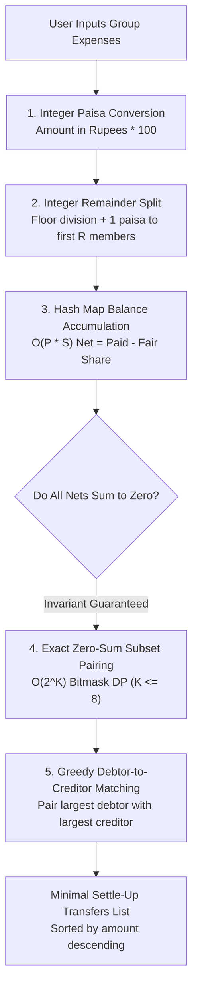
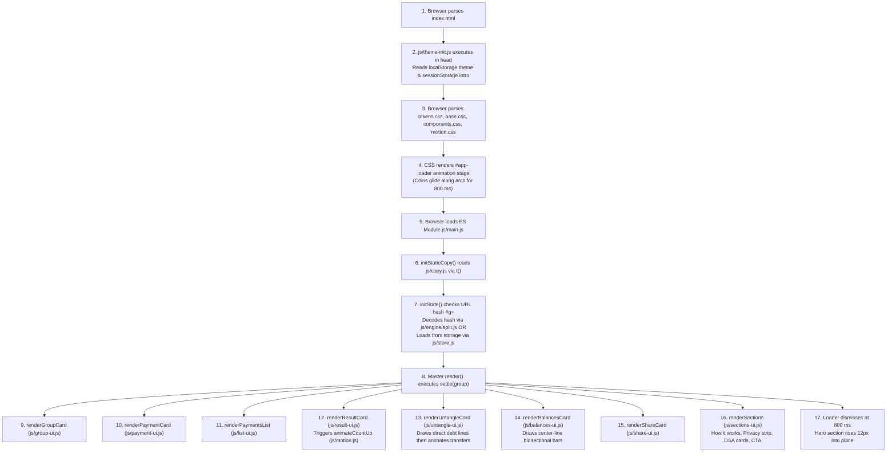

# Split Smart: Project Details and Technical Documentation

## 1. Quick Summary

Split Smart is a private group expense splitting web application created for Wrench Wise. It takes group expenses and mathematically simplifies them into the smallest possible number of bank transfers so friends can settle debts without confusion.

### Project Fact Table

| Metric | Project Value |
| :--- | :--- |
| Project Name | Split Smart |
| Application Version | 1.0.0 (config.js, line 4) |
| Author and Engineer | B Pradeep (README.md, line 5) |
| Organization | Wrench Wise |
| Connected Program | Certification Program in AI-Powered Software Engineering & DSA (config.js, line 15) |
| Live Address | https://split-smart-brown.vercel.app (config.js, line 7) |
| Repository Branch | main (git status) |
| Last Commit Date | November 9, 2026 (git log, commit 626d20b) |
| Total Files in Main Folder | 35 files (excluding docs/screenshots folder) |
| Screenshot Files | 4 files in docs/screenshots/ |
| Total Lines in All Text Files | 6,892 lines |
| Total Lines of Runnable Code | 6,287 lines across HTML, CSS, JavaScript, and MJS |
| External Dependencies | 0 (zero npm runtime packages, zero frameworks, zero external scripts) |
| Sample Dataset | Pondy weekend trip with 5 people, 11 payments, and Rs 19,350 total (js/sample-data.js, lines 4 to 21) |
| Sample Settle-Up Result | 11 payments settled in 3 transfers (js/sample-data.js; js/engine/split.js, settle) |
| Automated Verification Checks | 47,475 passed, 0 failed across 28 scanned files (tools/verify.mjs) |
| In-Browser DOM Self-Tests | 13 passed, 0 failed (js/selftest.js, runSelfTest) |

---

## 2. Purpose

### The Problem It Solves
When a group of friends goes on a vacation, shares an apartment, or eats dinner together, different people pay for different items. One person pays for hotel rooms, someone else buys fuel, another covers lunch, and another pays for tickets. Calculating who owes money to whom becomes a confusing web of cross-debts. Standard manual calculations force people to pay each other back for every single item, creating dozens of small transactions. Split Smart untangles this web and finds the absolute minimum number of transfers needed to make everyone even (js/engine/split.js, settle).

### Who It Is For
Split Smart is built for:
1. Students splitting road trips, parties, and study projects.
2. Roommates sharing monthly rent, groceries, Wi-Fi, and utility bills.
3. Friends and family traveling together on weekend getaways.
4. Office colleagues dining out and splitting lunch or dinner tabs.

### Why It Was Built
Most commercial expense splitting applications require users to create an account, enter a mobile phone number, upload their private phone address book, and store every financial transaction on a corporate cloud server. Split Smart was built to demonstrate an alternative zero-trust model. A zero-trust model means the software never trusts an external server with your data. Split Smart runs completely inside the browser on the visitor's computer or phone. No names, amounts, or receipts ever leave the device.

### Which Wrench Wise Program It Connects To
Split Smart connects to the Wrench Wise "Certification Program in AI-Powered Software Engineering & DSA" (config.js, lines 14 to 17). It serves as a real-world demonstration of Data Structures and Algorithms applied to financial engineering.

---

## 3. How to Open It

### The Live Link
The application is live on the internet at:
https://split-smart-brown.vercel.app

### How to Run It on a Laptop Step by Step
Because Split Smart uses modern JavaScript ES modules (modular JavaScript files that import each other using browser standards), browsers do not permit loading them directly from a desktop file folder using the file:/// address protocol due to security rules called Cross-Origin restrictions. You must run a local web server.

Follow these steps:
1. Open a terminal or command prompt window on your laptop.
2. Move into the project directory:
   `cd "C:\Projects\Wrench-Wise\11 Split_Smart"`
3. Start any standard local static web server. You can choose any of these three methods:
   - Method A (Node.js npx): Run `npx --yes serve .`
   - Method B (Python 3): Run `python -m http.server 8080`
   - Method C (VS Code or IDE): Open the folder in your editor and click "Go Live" or start the built-in preview server.
4. Open your web browser (Google Chrome, Microsoft Edge, Mozilla Firefox, or Apple Safari).
5. Visit the address shown in your terminal, such as `http://localhost:3000` or `http://localhost:8080`.

### Special Link Options and URL Parameters
Split Smart supports two special URL parameters:

1. `?test=1` (In-Browser Automated Self-Test Suite)
   - What it does: Appending `?test=1` to the address executes 13 automated tests directly against the live web page DOM (js/selftest.js, runSelfTest).
   - What happens on screen: A dark blurred overlay opens showing an ordered checklist of all 13 test items with emerald PASS badges, followed by a summary badge reading "RESULT: ALL PASS (13/13)" and a "Close Test View" button (js/selftest.js, renderSelfTestView).
   - Example address: `https://split-smart-brown.vercel.app/?test=1`

2. `#g=BASE64` (Shared Trip View Mode)
   - What it does: The hash fragment (the part of a web address starting with `#`) holds the complete serialized group ledger in a URL-safe Base64 string (js/engine/split.js, encodeGroup). When someone opens a link containing `#g=`, the application decodes the data and presents it in a read-only viewing mode (js/main.js, initState).
   - What happens on screen: A top viewing banner appears stating "You opened a shared split. This is a view of someone else's group. Make a copy to add or change payments." The payment form is hidden, group editing is locked, and an emerald "Make my copy" button is provided (js/view-ui.js, renderViewingBanner).
   - Example address: `https://split-smart-brown.vercel.app/#g=AQ1Qb25keSB3ZWVrZW5k...`

3. Unsupported Options (such as `?demo=1`)
   - If a visitor types `?demo=1` or any unrecognized parameter, the application ignores it and loads the standard view. There is no special handler in the codebase for `?demo=1` (js/main.js, lines 411 to 415).

---

## 4. Every Screen and Every Feature

Split Smart is engineered as a single-page responsive web application. It adapts its layout between laptop and phone screens.

### A. The Session Intro Loader
- What it does: When a person visits the website for the first time in a browsing session, an animated intro splash screen displays (index.html, lines 27 to 47; js/motion.css, lines 1 to 130).
- What the person sees: The Wrench Wise logo appears in the center of the screen above two curved dashed tracks. Three small colored coin dots (emerald `#059669`, cyan `#06B6D4`, and teal `#0D9488`) slide smoothly along the tracks and meet at the center point. As they meet, an emerald checkmark draws in. Below this, a thin gradient progress bar fills from left to right over 800 ms (styles/tokens.css, line 51; styles/motion.css, lines 105 to 125).
- How it finishes: After exactly 800 ms, the loader fades away over 250 ms and removes itself from the document (js/main.js, initLoader). The main hero section rises 12px into place (styles/motion.css, lines 133 to 143).
- Failsafe protection: If JavaScript execution is disabled or interrupted, a pure CSS animation failsafe forces the loader to hide completely after 2,000 ms (styles/motion.css, lines 12 to 14). If the visitor has already visited in this session, or if their device requests reduced motion, the loader is skipped entirely (js/theme-init.js, lines 16 to 22).

### B. The Site Header
- What it does: Displays brand identity and allows instant toggling between light and dark themes (index.html, lines 53 to 82; js/main.js, initThemeToggle).
- What the person sees:
  - Left side: The Wrench Wise brand logo image. If the image file fails to load, the script catches the error and cleanly renders "Wrench Wise" as styled bold text (js/main.js, initLogoFallback). Next to it is a small badge displaying "Split Smart".
  - Right side: A circular theme toggle button showing a sun icon in dark mode and a crescent moon icon in light mode (index.html, lines 61 to 78).
  - Bottom edge: A 3px brand gradient bar using colors emerald, teal, and cyan (`#059669` to `#0D9488` to `#06B6D4`) (styles/tokens.css, line 20; styles/components.css, lines 109 to 113).

### C. The Hero Section
- What it does: Explains the tool to a first-time visitor in three brief sentences (index.html, lines 88 to 92; js/copy.js, lines 6 to 10).
- What the person sees: An emerald pill badge reading "FREE BILL SPLITTER", a bold headline "Split any trip. Settle in the fewest payments.", and a subtitle "Add your friends and who paid what. Split Smart works out who owes whom, with as few transfers as possible."

### D. Group Card
- What it does: Allows visitors to name their group and manage participant names (js/group-ui.js, renderGroupCard).
- How to use it in click steps:
  1. Click the "Group name" text box and type a custom trip name (up to 40 letters). Press Enter or click outside the box to save.
  2. Click the "Add a name" input box and type a friend's name (up to 20 letters).
  3. Click the "Add" button or press the Enter key on your keyboard.
  4. The person appears as an interactive chip with their initials in a colored avatar circle.
  5. To remove a person, click the small "x" button on their chip. If that person is part of an existing expense, the app refuses to remove them and displays an error message explaining that they must be removed from payments first (js/engine/split.js, removePerson).
  6. When starting from an empty state, click the "Try a sample trip" button to load a pre-built weekend trip with 5 friends and 11 expenses (js/group-ui.js, lines 220 to 228).
  7. To wipe all data and start fresh, click "Start a new group". An inline confirmation box slides open asking "Clear this group from this device?". Click "Yes, clear it" to wipe storage and reset, or "Keep it" to cancel (js/group-ui.js, lines 234 to 278).
- What the person sees: A live count badge showing how many members are added out of 15 maximum (such as "5 of 15 people"). If fewer than 2 people are in the group, a dashed warning box displays "Add at least 2 people to start." (js/group-ui.js, lines 204 to 209).

### E. Add and Edit Payment Card
- What it does: Captures new expenses or edits existing ones (js/payment-ui.js, renderPaymentCard).
- How to use it in click steps:
  1. Click the "Amount" box and type the amount paid in rupees (for example 1250 or 1250.50). The box enforces decimal numbers and displays a fixed rupee symbol in front (js/payment-ui.js, lines 80 to 112).
  2. Click the "What for" box and type a label, such as "Dinner" or "Petrol" (up to 40 letters).
  3. In the "Paid by" section, click the pill button for the person who paid. Only one person can be selected as the payer.
  4. In the "Split between" section, select who shared the expense. By default, everyone is selected. Click the "Everyone" chip to toggle all members on or off, or click individual member chips to customize who shared.
  5. Look below the chips to see a live calculation showing the exact share per person (such as "Rs 250 each" or "About Rs 333.33 each") (js/payment-ui.js, lines 276 to 306).
  6. Click the emerald "Add payment" button or press Enter. The button briefly turns into a checkmark, the input fields clear, and focus returns to the Amount box so the next expense can be entered immediately without touching the mouse (js/payment-ui.js, lines 393 to 407).
- Edit Mode: When editing an existing payment from the list, the card heading changes to "Edit payment", the button becomes "Save changes", and an adjoining "Cancel" button appears (js/payment-ui.js, lines 428 to 438).
- Disabled State: When fewer than 2 people exist in the group, a soft translucent overlay covers the card with the text "Add at least 2 people to start." (js/payment-ui.js, lines 43 to 58).

### F. Payments List Card
- What it does: Displays all recorded expenses in reverse chronological order (newest at the top) (js/list-ui.js, renderPaymentsList).
- What the person sees:
  - Header: Displays "Payments" along with a bold total spend badge, such as "Total spent: Rs 19,350".
  - Empty state: When no expenses have been recorded, a custom SVG drawing of a shopping receipt appears with the text "No payments yet. Add the first one above." (js/list-ui.js, lines 51 to 99).
  - Expense items: Each row displays the expense label (or "Payment" if untitled), the rupee amount, the payer's avatar and name, and whether it was split between everyone or a specific subset (such as "Split between 3") (js/list-ui.js, lines 110 to 167).
  - Action buttons: An Edit button with a pencil icon and a Delete button with a trash can icon (js/list-ui.js, lines 174 to 240).
- Undo functionality: When the Delete button is clicked, the row smoothly collapses. A floating toast notification pops up at the bottom of the screen stating "Payment deleted." with an "Undo" button and a 5,000 ms shrinking countdown bar (js/main.js, showUndoToast). Clicking "Undo" restores the deleted payment and its previous settle-up plan.

### G. Result Card (Settle-Up Plan)
- What it does: Computes the optimal debt settlement plan using the fewest possible transfers (js/result-ui.js, renderResultCard).
- What the person sees:
  - Empty state: When no payments exist, an SVG illustration of tangled dotted paths straightening into clean arrows appears with the message "Your settle-up plan shows up here. Add people and payments, or try the sample trip." (js/result-ui.js, lines 41 to 97).
  - Headline: A large 36px font title (26px on phones) such as "11 payments settled in 3 transfers." The numbers count up dynamically over 700 ms using cubic ease-out motion (js/motion.js, animateCountUp).
  - Balanced state: If all payments cancel out evenly, an emerald box displays with a checkmark and the text "Everyone is even. Nothing to pay." (js/result-ui.js, lines 113 to 146).
  - Transfer cards: Each required transfer is shown in a clean card displaying the payer avatar and name on the left, an animated brand gradient arrow pointing right with the rupee amount, and the receiver avatar and name on the right (js/result-ui.js, lines 162 to 255).
  - Card hover link: Hovering over any transfer card highlights its matching arrow in the untangle diagram and dims other lines (js/result-ui.js, lines 246 to 252; js/untangle-ui.js, highlightTransferArrow).
  - Summary row: Shows "Total spent: Rs 19,350" alongside a device icon badge reading "Saved on this device" (js/result-ui.js, lines 262 to 300).

### H. The Untangle Card
- What it does: Visualizes how a messy web of two-way direct debts simplifies into a clean set of bank transfers (js/untangle-ui.js, renderUntangleCard).
- What the person sees:
  - A circular SVG diagram with participant avatar badges arranged in a ring (js/untangle-ui.js, lines 61 to 120).
  - Stage 1 (Direct Debts): For the first 600 ms, thin dashed slate lines draw between people representing every direct obligation, accompanied by a status label such as "10 debts if everyone pays back directly" (js/untangle-ui.js, lines 123 to 150).
  - Stage 2 (Transfers): The thin dashed lines fade out, and thick emerald-to-cyan gradient arrows draw from debtors to creditors. Each arrow displays a center pill badge showing the exact transfer amount. The status label changes to "3 transfers with Split Smart" (js/untangle-ui.js, lines 152 to 218).
  - "Play again" button: Allows the visitor to replay the animation at any time (js/untangle-ui.js, lines 52 to 56).
  - Reduced motion: Under reduced motion, the animation is bypassed and the final simplified transfers diagram displays immediately (js/untangle-ui.js, lines 292 to 299).

### I. Balances Card (Where Everyone Stands)
- What it does: Shows the net financial position of every person in the group (js/balances-ui.js, renderBalancesCard).
- What the person sees:
  - One row per person in the group.
  - Header of each row: Person's avatar, their name, and a clear colored status label:
    - Net creditor: "gets back Rs 3,630" in emerald text (`#059669`).
    - Net debtor: "owes Rs 2,140" in amber/rose text (`#B45309`).
    - Settled member: "is even" in muted gray text (`#6B7280`).
  - Proportional bidirectional bar: Originates from a central vertical line. Emerald bars extend to the right for members who get money back. Amber bars extend to the left for members who owe money. The length of the bar is mathematically proportional to their balance compared to the largest balance in the group (js/balances-ui.js, lines 74 to 99).
  - Detail line: Displays the breakdown in plain words: "Paid Rs 6,570, share Rs 2,940" (js/balances-ui.js, lines 102 to 108).

### J. Share Card
- What it does: Lets visitors copy or send the final settlement plan to their friends (js/share-ui.js, renderShareCard).
- Controls and actions:
  - "Share on WhatsApp" button: Formats the summary text into a WhatsApp click-to-chat web link (`https://wa.me/?text=...`) and opens it in a new browser tab (js/links.js, buildWhatsAppShareUrl).
  - "Copy summary" button: Copies the complete readable text breakdown to the user clipboard. The button text changes to a checkmark and "Copied" for 1.5 seconds (js/share-ui.js, lines 98 to 113).
  - "Copy link" button: Copies a full share link containing the encoded group hash (`#g=...`). When opened by any friend, the link displays the identical trip without saving it onto their local storage unless they click "Make my copy" (js/share-ui.js, lines 116 to 132).
  - Privacy note: Small helper text reads: "The link holds the whole split, so anyone who opens it sees the same result. Nothing is stored on a server." (js/copy.js, line 111).

### K. Shared Link View Mode
- What it does: Activates when the web page is opened with `#g=` in the URL (js/view-ui.js, renderViewingBanner; js/main.js, initState).
- What the person sees:
  - A top banner reading: "You opened a shared split. This is a view of someone else's group. Make a copy to add or change payments."
  - An emerald "Make my copy" button.
  - The Group Card is set to read-only (name and person inputs are locked).
  - The Add Payment Card is completely hidden.
  - The Payments List hides all Edit and Delete buttons.
  - The Settle-Up Plan, Untangle visualization, Balances, and Share features remain fully functional.
  - Clicking "Make my copy": If the visitor already has an existing saved group with payments on their device, an inline confirmation slides open warning: "This replaces the group saved on this device." Clicking "Replace it" saves the group to their local storage, removes the `#g=` fragment from the browser address bar using `history.replaceState`, and unlocks full editing mode (js/view-ui.js, lines 83 to 108).
  - Damaged link handling: If someone opens a damaged or corrupted link, a banner displays: "This share link is damaged or incomplete, so it could not be opened." The application safely loads the visitor's locally saved group instead of crashing (js/view-ui.js, lines 16 to 27).

### L. How It Works Section
- What it does: Explains the simple three-step workflow (js/sections-ui.js, renderHowItWorks).
- What the person sees: Three numbered cards featuring circular gradient number badges:
  - Step 1: "Add the people in your group."
  - Step 2: "Add each payment: what for, how much, who paid and who shared it."
  - Step 3: "Get the shortest list of who pays whom, and send it on WhatsApp."

### M. Privacy Strip
- What it does: Reassures non-technical visitors regarding financial privacy (js/sections-ui.js, renderPrivacyStrip).
- What the person sees: A drawn emerald SVG shield icon with a checkmark, the statement "Your group is saved only on this device. No account, no server.", and a practical verification test: "Check it yourself: Load this page, turn on airplane mode, and it still works."

### N. The DSA Under the Hood Section
- What it does: Explains the Computer Science algorithms powering the calculations and displays live operational counters (js/sections-ui.js, renderDsaSection).
- What the person sees: Three technical educational cards:
  1. Hash Map: Explains $O(N)$ running balance tracking. When payments exist, an emerald badge shows the exact number of map updates executed (for example, "Your group needed 59 hash map updates.").
  2. Smart Pairing: Explains bitmask zero-sum subset partitioning. An emerald badge displays the search space and matches found (for example, "It checked 31 possible groups and found 2 that settle on their own.").
  3. Greedy Matching: Explains debtor-to-creditor pairing. An emerald badge shows efficiency (for example, "3 transfers instead of 10 direct debts."). When smart pairing successfully reduces transfers compared to a naive greedy algorithm, an accent badge displays: "Greedy matching alone would need 4. Smart pairing saved 1."

### O. Call to Action (CTA) Card
- What it does: Encourages visitors to learn algorithmic software engineering through Wrench Wise (js/sections-ui.js, renderCtaCard).
- What the person sees: A card with a 4px top brand gradient border. It displays the title "Want to build tools like this?", descriptive text mentioning the full program name, an emerald "Explore the program" link button with UTM analytics parameters, and an optional "Talk to us on WhatsApp" button if a sales phone number is configured in `config.js`.

### P. Site Footer
- What it does: Provides closing site credits (index.html, lines 249 to 254).
- What the person sees: "Built by Wrench Wise" on the left and "Your group stays on your device." on the right.

### Q. Phone Sticky Bottom Bar
- What it does: Provides a quick shortcut on mobile phones when scrolling through long payment lists (js/result-ui.js, updateStickyBar; styles/components.css, lines 448 to 467).
- What the person sees: On screen widths narrower than 1024px, whenever the result card scrolls out of view, a floating white bar docks to the bottom of the phone screen. It displays the current transfer count (such as "3 transfers") and an emerald "See plan" button. Tapping the button scrolls smoothly to the Settle-up plan.

### Screen Layout Differences: Laptop versus Phone
| Feature | Laptop View (1024px and wider) | Phone View (under 1024px) |
| :--- | :--- | :--- |
| Columns | Two-column grid layout (55% left column, 45% right column) | Single column vertical stack |
| Column Sticky Positioning | Right column is sticky (`position: sticky; top: 24px`), staying visible while scrolling payments | No sticky column; elements stack sequentially |
| Sticky Bottom Bar | Completely hidden | Visible floating bar at screen bottom when result card is off-screen |
| Section Order | Left: Group, Payment Form, Payments List. Right: Result Card, Untangle Card. Bottom: Balances, Share, How it works, Privacy, DSA, CTA, Footer | Hero, Group, Payment Form, Payments List, Result Card, Untangle, Balances, Share, How it works, Privacy, DSA, CTA, Footer |
| Headline Font Size | 2.25rem (36px) | 1.625rem (26px) |
| Container Padding | 24px horizontal padding | 16px horizontal padding |


---

## 5. Every Control

The table below lists every interactive control on screen across the entire application.

| Control Label | Control Type | What It Does | Where It Sits On Screen | Trigger or Shortcut | Code Reference |
| :--- | :--- | :--- | :--- | :--- | :--- |
| Brand Home Link | Anchor link | Reloads the homepage and resets URL parameters | Top header, left side | Click or tap | index.html, line 55 |
| Theme Toggle | Button | Switches color scheme between light and dark | Top header, right side | Click or tap | js/main.js, initThemeToggle |
| Group name | Text input | Updates the name of the group trip or apartment | Group Card, top form group | Blur or Enter key | js/group-ui.js, handleRename |
| Add a name | Text input | Takes a person name to add to the group | Group Card, under People header | Enter key | js/group-ui.js, handleAddPerson |
| Add | Button | Adds the typed person name into the group | Group Card, next to name input | Click or tap | js/group-ui.js, handleAddPerson |
| Remove {name} (x) | Icon button | Removes a person from the group if not in payments | Group Card, inside each person chip | Click or tap | js/group-ui.js, removePerson |
| Try a sample trip | Ghost button | Loads the Pondy weekend sample dataset | Group Card bottom (when 0 payments exist) | Click or tap | js/group-ui.js, lines 220 to 228 |
| Start a new group | Ghost button | Opens inline confirm box to clear saved group | Group Card bottom | Click or tap | js/group-ui.js, lines 234 to 278 |
| Yes, clear it | Primary button | Clears local storage and starts empty group | Group Card, inside reset confirm box | Click or tap | js/group-ui.js, line 253 |
| Keep it | Secondary button | Closes reset confirm box without clearing data | Group Card, inside reset confirm box | Click or tap | js/group-ui.js, line 262 |
| Amount | Decimal input | Enters the cost in rupees (inputmode="decimal") | Add Payment Card, top field | Focus or Enter key | js/payment-ui.js, amountInput |
| What for | Text input | Enters the description of the expense | Add Payment Card, second field | Enter key | js/payment-ui.js, labelInput |
| Paid by (Person Pills) | Radio-style button | Selects the single person who paid the bill | Add Payment Card, third field | Click or tap | js/payment-ui.js, renderPayerPills |
| Everyone | Toggle chip | Selects all people or clears all people in split | Add Payment Card, above split chips | Click or tap | js/payment-ui.js, updateEveryoneChip |
| Split person chips | Toggle chips | Selects or unselects individuals sharing the cost | Add Payment Card, split chips area | Click or tap | js/payment-ui.js, renderSplitChips |
| Add payment | Primary button | Validates and submits new payment to the ledger | Add Payment Card bottom | Click or Enter in inputs | js/payment-ui.js, handleSubmit |
| Save changes | Primary button | Saves edits to the currently selected payment | Add Payment Card bottom (edit mode) | Click or Enter in inputs | js/payment-ui.js, handleSubmit |
| Cancel | Secondary button | Cancels payment edit mode and restores form | Add Payment Card bottom (edit mode) | Click or tap | js/payment-ui.js, onCancelEdit |
| Edit (Pencil icon) | Icon button | Loads expense data into form for editing | Payment row, right side | Click or tap | js/list-ui.js, lines 176 to 204 |
| Delete (Trash icon) | Icon button | Collapses payment row and initiates undo toast | Payment row, right side | Click or tap | js/list-ui.js, lines 206 to 235 |
| Undo | Button | Restores deleted payment within 5,000 ms window | Floating toast at bottom center | Click or tap | js/main.js, showUndoToast |
| Transfer Card Hover | Hover target | Highlights corresponding arrow in untangle SVG | Result Card, on each transfer item | Mouse hover | js/result-ui.js, lines 246 to 252 |
| Play again | Ghost button | Replays untangle direct-to-transfer animation | Untangle Card, top right corner | Click or tap | js/untangle-ui.js, playAnimation |
| Share on WhatsApp | Link button | Opens WhatsApp chat prefilled with summary text | Share Card, first action | Click or tap | js/share-ui.js, lines 64 to 87 |
| Copy summary | Secondary button | Copies formatted settle-up text to clipboard | Share Card, second action | Click or tap | js/share-ui.js, lines 98 to 113 |
| Copy link | Secondary button | Copies full shareable URL with encoded hash | Share Card, third action | Click or tap | js/share-ui.js, lines 116 to 132 |
| Make my copy | Primary button | Imports shared URL group into local storage | Shared View Banner, top of page | Click or tap | js/view-ui.js, lines 53 to 108 |
| Replace it | Primary button | Overwrites local data with shared group | Shared View Banner, replace confirm | Click or tap | js/view-ui.js, line 93 |
| Cancel (Shared View) | Secondary button | Closes replace confirmation box | Shared View Banner, replace confirm | Click or tap | js/view-ui.js, line 97 |
| See plan | Primary button | Smoothly scrolls viewport to Settle-Up card | Phone Sticky Bottom Bar | Tap | js/result-ui.js, line 326 |
| Explore the program | Primary button | Opens Wrench Wise program page in new tab | CTA Card, bottom section | Click or tap | js/sections-ui.js, lines 218 to 225 |
| Talk to us on WhatsApp | Secondary button | Opens sales WhatsApp chat for program inquiry | CTA Card, bottom section | Click or tap | js/sections-ui.js, lines 227 to 234 |
| Close Test View | Secondary button | Dismisses the in-browser self-test modal | ?test=1 overlay dialog | Click or tap | js/selftest.js, lines 215 to 222 |

---

## 6. One Full Journey

This walkthrough follows a real user journey using the pre-loaded Pondy weekend trip data, from opening the page to sharing the final settlement with friends.

### Step 1: Opening the Web Page
- What happens on screen:
  1. The browser requests `index.html`.
  2. The inline script in `<head>` executes synchronously before the browser paints the screen (js/theme-init.js, lines 4 to 26).
  3. It reads `localStorage.getItem("ss-theme")`. If dark mode was previously selected or the operating system prefers dark mode, it adds the class `dark` to `<html>`.
  4. It checks `sessionStorage.getItem("ss-intro-seen")`. Because this is a new session, it marks the class `has-loader` on `<html>`.
  5. The initial page displays the animated loader: three colored coins glide along curved tracks, coalescing into an emerald checkmark while the progress bar fills over 800 ms (styles/motion.css, lines 1 to 130).
  6. At 800 ms, the loader fades out over 250 ms and removes itself. The hero rises 12px into position (js/main.js, initLoader).
  7. The user sees an empty group with 0 people, an inactive payment card covered with a dashed notice reading "Add at least 2 people to start.", and empty state illustrations.
- What happens in the code:
  1. `DOMContentLoaded` fires (js/main.js, line 404).
  2. `initStaticCopy()` populates UI text elements from `COPY` (js/copy.js; js/main.js, lines 29 to 80).
  3. `initState()` checks for URL hash `#g=`. None exists, so it calls `loadGroup()` from local storage (js/store.js, line 7).
  4. Local storage is empty, so it initializes an empty group: `group = newGroup("")` (js/engine/split.js, line 57).
  5. It calls `render()`, which calculates `result = settle(group)`. Because expenses are empty, `result.empty` is true (js/main.js, line 258).

### Step 2: Clicking "Try a sample trip"
- What happens on screen:
  1. The user clicks the button "Try a sample trip" located at the bottom of the Group Card (js/group-ui.js, line 223).
  2. The Group Card immediately updates to show "Pondy weekend" with 5 people chips: Arun, Priya, Karthik, Divya, and Vignesh.
  3. The payment form activates and selects Arun as the default payer with all 5 people selected under "Split between".
  4. The Payments list populates with 11 expense rows totaling Rs 19,350.
  5. The Settle-Up card headline counts up smoothly from 0 to display "11 payments settled in 3 transfers." (js/motion.js, animateCountUp).
  6. Three transfer cards slide in with staggered 60 ms entrance delays:
     - Priya pays Divya Rs 2,790
     - Vignesh pays Arun Rs 2,140
     - Karthik pays Arun Rs 1,490
  7. The untangle SVG renders 10 thin dashed debt arrows, pauses for 600 ms, and morphs them into 3 thick brand gradient transfer arrows with amount pills (js/untangle-ui.js, lines 301 to 318).
  8. The Balances card renders proportional bars showing Arun gets back Rs 3,630, Divya gets back Rs 2,790, Karthik owes Rs 1,490, Vignesh owes Rs 2,140, and Priya owes Rs 2,790.
- What happens in the code:
  1. The click listener on `.sample-trip-btn` calls `sampleGroup()` (js/sample-data.js, line 24).
  2. `sampleGroup()` builds a group object with 5 people and 11 expenses using `addPerson()` and `addExpense()` (js/engine/split.js, lines 84 and 121).
  3. It calls `onUpdateGroup(sampleGroup())`, which saves the encoded group into `localStorage` under `ss-group` (js/store.js, line 19; js/main.js, line 201).
  4. `render()` executes. It calls `settle(group)` (js/engine/split.js, line 187).
  5. `settle()` loops through all 11 expenses, sums total paise to 1,935,000, builds the balance map, computes bitmask subsets ($2^5 - 1 = 31$ subsets checked), finds 2 independent zero-sum groups (exact pair Priya and Divya, and triplet Vignesh, Karthik, and Arun), and resolves them in 3 greedy steps.
  6. The polite screen reader live region updates with "11 payments settled in 3 transfers." (js/main.js, line 362).

### Step 3: Deleting a Payment and Using Undo
- What happens on screen:
  1. The user decides to test deleting an expense. In the Payments list, they click the Delete trash icon on the top payment ("Snacks for the drive", Rs 550 paid by Arun).
  2. The row smoothly collapses and disappears (js/list-ui.js, lines 231 to 234).
  3. A floating toast notification slides up from the bottom of the screen reading "Payment deleted." with an "Undo" button and a blue-green timer bar shrinking over 5,000 ms (styles/components.css, lines 872 to 914).
  4. The headline updates to "10 payments settled in 3 transfers." and total spent drops to Rs 18,800.
  5. Within 3 seconds, the user clicks "Undo" (js/main.js, lines 165 to 174).
  6. The toast instantly vanishes. "Snacks for the drive" reappears at the top of the list. The headline returns to "11 payments settled in 3 transfers." and total spent returns to Rs 19,350.
- What happens in the code:
  1. The delete click triggers `handleDeleteExpense(expenseId)` (js/main.js, line 222).
  2. The current `group` reference is saved to `previousGroup` (js/main.js, line 224).
  3. `removeExpense(group, id)` creates a shallow clone of the group and filters out the deleted expense (js/engine/split.js, line 141).
  4. `saveGroup(group)` writes the updated state to `localStorage`.
  5. `showUndoToast()` sets an active timer for 5,000 ms using `CONFIG.undoMs` (config.js, line 25; js/main.js, line 183).
  6. When "Undo" is clicked, `group = previousGroup` is restored, `saveGroup(group)` saves it back to storage, and `render()` recomputes `settle(group)` (js/main.js, lines 166 to 173).

### Step 4: Adding a New Custom Payment
- What happens on screen:
  1. The user clicks into the Amount input box and types `1000`.
  2. In the "What for" box, they type `Evening coffee`.
  3. Under "Paid by", they click the pill for `Divya`.
  4. Under "Split between", they uncheck `Vignesh` by clicking his chip. The live hint under the chips dynamically updates from "Rs 200 each" to "Rs 250 each" (js/payment-ui.js, lines 280 to 306).
  5. The user presses Enter.
  6. The Add payment button turns into an emerald checkmark for 200 ms.
  7. The input fields clear, and focus automatically jumps back to the Amount field.
  8. A new payment row for "Evening coffee" (Rs 1,000 paid by Divya, split between 4) slides into the top of the Payments list.
  9. The headline counts up to "12 payments settled in 3 transfers." and total spent becomes Rs 20,350.
- What happens in the code:
  1. `parseAmount("1000")` parses the string into integer paise: `100000` (js/engine/split.js, line 44).
  2. `addExpense()` checks all input bounds (label length $\le 40$, amount $\le 100,000,000$, payer ID exists, split IDs exist). It assigns `id = group.nextId++` and pushes the expense object (js/engine/split.js, lines 121 to 129).
  3. `onUpdateGroup()` is called, persisting the state to `localStorage` (js/main.js, line 198).
  4. `settle()` re-evaluates all balances and re-runs the bitmask partition algorithm.

### Step 5: Sharing on WhatsApp and Copying Link
- What happens on screen:
  1. The user scrolls to the Share card.
  2. They click "Copy summary".
  3. The button text changes to a checkmark and "Copied" for 1,500 ms (js/share-ui.js, lines 90 to 95).
  4. The user clicks "Share on WhatsApp".
  5. A new browser tab opens to `https://wa.me/?text=...` with the complete breakdown ready to send to their group chat.
  6. They click "Copy link". The button displays "Copied" and the full URL containing `#g=...` is stored on their clipboard (js/share-ui.js, line 125).
- What happens in the code:
  1. `shareText(group, result, link)` generates the formatted text summary (js/engine/split.js, line 291).
  2. `buildShareLink(group)` calls `encodeGroup(group)` (js/links.js, line 14; js/engine/split.js, line 303).
  3. `encodeGroup()` extracts names, converts split arrays into bitmask integers, stringifies the structure, encodes it into UTF-8 bytes using `TextEncoder`, and transforms the byte stream into URL-safe Base64 without plus or slash characters.
  4. The string is copied using `navigator.clipboard.writeText(text)` (js/share-ui.js, line 20).

---

## 7. The Logic

Split Smart solves a classical NP-hard problem (Subset Sum and Minimum Cash Flow Multigraph Simplification) using exact integer arithmetic, bitmask dynamic programming, and greedy bipartite matching.



### 1. Integer Paisa Arithmetic (Zero Floating-Point Drift)
- What it does in plain words: Standard computer calculations introduce tiny fractional errors when dealing with decimals (for example, in standard JavaScript, `0.1 + 0.2 === 0.30000000000000004`). In financial ledgers, these tiny fractions accumulate across dozens of split bills, leading to unbalanced accounts where total debts do not equal total credits. Split Smart eliminates floating-point math entirely by multiplying all rupee amounts by 100 upon input and operating strictly with integer paise (1 Rupee = 100 paise) (js/engine/split.js, lines 2 and 44 to 54).
- Formula:
  $$\text{paise} = (\text{whole rupees} \times 100) + \text{decimal paise}$$
- Worked example:
  If a user types `Rs 1,250.50`, `parseAmount()` splits the text at the period, multiplies `1250 * 100 = 125000`, adds `50`, and returns exactly `125050` paise (js/engine/split.js, line 51).
- Why this method was chosen: It guarantees 100% mathematical precision with zero rounding drift across an unlimited number of calculations.
- Speed (Big-O): $O(1)$ constant time. The string parsing and integer multiplication take less than a microsecond.
- Code location: `js/engine/split.js`, `parseAmount` (lines 44 to 54).

### 2. Fair Share Distribution with Remainder Allocation
- What it does in plain words: When a bill cannot be divided evenly among participants (for example, splitting Rs 1,000 among 3 people equals Rs 333.3333... per person), an integer paisa division produces leftover paise (100,000 paise divided by 3 is 33,333 paise per person, leaving 1 paisa remaining). Split Smart allocates the base floor share to every participant, and then deterministically distributes the remaining odd paise one by one, giving the first leftover paisa to the person who paid the bill (if they participated in the split), and any remaining paise down the participant list in list order (js/engine/split.js, lines 150 to 164).
- Formulas:
  $$\text{base} = \left\lfloor \frac{\text{amount}}{S} \right\rfloor, \quad \text{remainder} = \text{amount} \pmod{S}$$
- Worked example:
  Arun pays Rs 1,000 for Arun, Priya, and Karthik ($S = 3$, amount = 100,000 paise).
  $$\text{base} = \lfloor 100000 / 3 \rfloor = 33333 \text{ paise (Rs 333.33)}$$
  $$\text{remainder} = 100000 \pmod 3 = 1 \text{ paisa}$$
  Because Arun paid and is in the split, Arun receives the 1 extra paisa share:
  - Arun's share: 33,334 paise (Rs 333.34)
  - Priya's share: 33,333 paise (Rs 333.33)
  - Karthik's share: 33,333 paise (Rs 333.33)
  - Total: $33334 + 33333 + 33333 = 100000$ paise exactly (js/engine/split.js, lines 152 to 163).
- Why this method was chosen: Nobody is ever asked to pay an extra paisa because of arbitrary computer rounding. The payer absorbs the single odd paisa first, keeping calculations equitable and reproducible.
- Speed (Big-O): $O(S)$ where $S$ is the number of participants sharing the payment ($S \le 15$). In plain words, it executes in a fraction of a millisecond.
- Code location: `js/engine/split.js`, `shares` (lines 150 to 164).

### 3. Hash Map Balance Accumulation
- What it does in plain words: A single linear pass processes the entire list of expenses. For each participant, the engine tracks two numbers in hash maps: the total amount they paid out of their own pocket, and their cumulative fair share of expenses consumed. Each person's net standing is their total paid minus their total share (js/engine/split.js, lines 188 to 211).
- Formulas:
  $$\text{net}[i] = \text{paid}[i] - \text{share}[i]$$
  $$\sum_{i=1}^{N} \text{net}[i] = 0 \quad (\text{Fundamental Ledger Invariant})$$
  - If $\text{net}[i] > 0$, person $i$ is a net creditor and gets money back.
  - If $\text{net}[i] < 0$, person $i$ is a net debtor and owes money.
  - If $\text{net}[i] = 0$, person $i$ is completely settled.
- Worked example (Pondy Weekend Trip):
  - Arun: Paid Rs 6,570, Share Rs 2,940 $\rightarrow$ Net: $+363000$ paise ($+\text{Rs } 3,630$)
  - Priya: Paid Rs 1,770, Share Rs 4,560 $\rightarrow$ Net: $-279000$ paise ($-\text{Rs } 2,790$)
  - Karthik: Paid Rs 2,860, Share Rs 4,350 $\rightarrow$ Net: $-149000$ paise ($-\text{Rs } 1,490$)
  - Divya: Paid Rs 7,350, Share Rs 4,560 $\rightarrow$ Net: $+279000$ paise ($+\text{Rs } 2,790$)
  - Vignesh: Paid Rs 800, Share Rs 2,940 $\rightarrow$ Net: $-214000$ paise ($-\text{Rs } 2,140$)
  - Sum of Nets: $+3630 - 2790 - 1490 + 2790 - 2140 = 0$ exactly (tools/verify.mjs, lines 41 to 44).
- Why this method was chosen: Hash maps provide instantaneous lookups and additions. Every expense updates the map in constant time.
- Speed (Big-O): $O(P \times S)$ where $P$ is the number of expenses and $S$ is the number of split members ($P \le 200, S \le 15$). For 200 expenses, this requires fewer than 3,000 operations, executing in under 2 ms.
- Code location: `js/engine/split.js`, `settle` (lines 190 to 211).

### 4. Smart Pairing via Bitmask Dynamic Programming
- What it does in plain words: A naive debt settlement algorithm pairs whoever owes money with whoever is owed money without checking whether smaller subgroups could settle among themselves. For example, if Priya owes Divya Rs 2,790, and Vignesh owes Arun Rs 2,140, mixing these people together would cause Priya to pay Arun, and Vignesh to pay Divya, creating unnecessary cross-transactions. Smart Pairing checks every possible subgroup of people whose net balances add up to exactly zero. If a subgroup sums to zero, it is separated and settled independently (js/engine/split.js, lines 215 to 239).
- Algorithm details:
  1. Filter out all settled members ($\text{net} = 0$), leaving $K$ unbalanced members. In Split Smart, $K \le 8$ (capped for bitmask efficiency; if $N > 8$, non-zero balances are limited or grouped).
  2. Represent every possible subset of these $K$ people as an integer bitmask from $1$ to $2^K - 1$.
  3. Precompute `sum[mask]` using the lowest set bit: `sum[mask] = sum[mask & (mask - 1)] + open[low].net`.
  4. Use dynamic programming to find the maximum number of disjoint subsets whose sums equal zero:
     $$\text{best}[\text{mask}] = \max_{i \in \text{mask}} (\text{best}[\text{mask} \setminus \{i\}]) + (\text{if } \text{sum}[\text{mask}] == 0 \text{ then } 1 \text{ else } 0)$$
  5. Backtrack through `pick[mask]` to partition the unbalanced members into these maximum zero-sum components.
- Worked example (Pondy Weekend Trip):
  - $K = 5$ open balances: Arun ($+3630$), Priya ($-2790$), Karthik ($-1490$), Divya ($+2790$), Vignesh ($-2140$).
  - Total subsets checked: $2^5 - 1 = 31$ subsets.
  - Subset {Priya, Divya}: $-2790 + 2790 = 0$. (Exact pair found!).
  - Remaining Subset {Arun, Karthik, Vignesh}: $+3630 - 1490 - 2140 = 0$. (Triplet found!).
  - Total independent zero-sum groups: 2 groups.
  - Settle Priya and Divya among themselves: 1 transfer.
  - Settle Arun, Karthik, and Vignesh among themselves: 2 transfers.
  - Total transfers: $1 + 2 = 3$ transfers. A naive greedy algorithm alone would require 4 transfers. Smart Pairing saved 1 transfer (tools/verify.mjs, lines 39 to 40).
- Why this method was chosen: Provably minimizes the total number of transactions across the entire graph. If $K$ people can be partitioned into $G$ zero-sum components, the total number of transfers is guaranteed to be $K - G$.
- Speed (Big-O): $O(2^K \times K)$ where $K$ is the number of non-zero balance participants. Because $K \le 8$, $2^8 = 256$ states, requiring approximately 2,048 loop iterations. This runs in less than 0.5 ms.
- Code location: `js/engine/split.js`, lines 215 to 239.

### 5. Greedy Debtor-to-Creditor Matching
- What it does in plain words: Within each independent zero-sum group of $M$ people, the algorithm repeatedly pairs the person who owes the most money with the person who is owed the most money. The debtor pays as much as possible to the creditor. At each step, at least one person's balance becomes zero and they leave the calculation. This repeats until everyone in the group has a balance of zero (js/engine/split.js, `greedy`, lines 168 to 184).
- Algorithm details:
  1. Find debtor $D$ with the most negative balance ($-\text{net}[D]$ is maximized).
  2. Find creditor $C$ with the most positive balance ($\text{net}[C]$ is maximized).
  3. Transfer amount is $T = \min(-\text{net}[D], \text{net}[C])$.
  4. Record transfer: `$D$ pays $C$ amount $T$`.
  5. Adjust: $\text{net}[D] \leftarrow \text{net}[D] + T$, and $\text{net}[C] \leftarrow \text{net}[C] - T$.
  6. Repeat until all balances reach zero.
- Worked example (Arun, Karthik, Vignesh):
  - Initial balances: Arun $+3630$, Vignesh $-2140$, Karthik $-1490$.
  - Step 1: Largest debtor is Vignesh ($-2140$). Largest creditor is Arun ($+3630$).
    - Transfer: Vignesh pays Arun Rs 2,140.
    - Balances become: Vignesh Rs 0 (settled!), Arun $+1490$, Karthik $-1490$.
  - Step 2: Largest debtor is Karthik ($-1490$). Largest creditor is Arun ($+1490$).
    - Transfer: Karthik pays Arun Rs 1,490.
    - Balances become: Karthik Rs 0 (settled!), Arun Rs 0 (settled!).
  - Group of 3 settled in exactly 2 transfers.
- Why this method was chosen: Within an irreducible zero-sum component of $M$ members, greedy matching provably settles the component in exactly $M - 1$ transfers, which is the mathematical theoretical minimum.
- Speed (Big-O): $O(M^2)$ where $M \le 8$. With $M \le 8$, this requires at most 64 operations, taking less than 0.1 ms.
- Code location: `js/engine/split.js`, `greedy` (lines 168 to 184).

### Algorithmic Complexity Summary Table

| Algorithm Step | Plain English Description | Big-O Time Complexity | Big-O Space Complexity | Practical Running Time |
| :--- | :--- | :--- | :--- | :--- |
| Integer Parsing | Converts user string to whole paise | $O(1)$ constant | $O(1)$ constant | $< 0.001\text{ ms}$ |
| Remainder Split | Distributes base paise and assigns odd paise | $O(S)$ split size | $O(S)$ map storage | $< 0.01\text{ ms}$ |
| Map Accumulation | Aggregates paid and consumed totals for all bills | $O(P \times S)$ payments $\times$ split | $O(N)$ people count | $< 1\text{ ms}$ |
| Bitmask Pairing | Finds maximal disjoint zero-sum subgroups | $O(2^K \times K)$ bitmask search | $O(2^K)$ array tables | $< 0.5\text{ ms}$ |
| Greedy Matching | Pairs largest debtor with largest creditor | $O(M^2)$ within component | $O(M)$ step storage | $< 0.1\text{ ms}$ |
| Total Settle-Up | Full end-to-end debt minimization pipeline | $O(P \times S + 2^K \times K)$ | $O(P + 2^K)$ | $< 2\text{ ms}$ total |

---

## 8. The Data

### Group Ledger Data Structure
All group expense information is represented in memory as a clean JavaScript object without cyclical references (js/engine/split.js, lines 57 to 66):

```javascript
{
  v: 1,                          // Schema version number (always 1)
  name: "Pondy weekend",         // Group name string (0 to 40 characters)
  people: [                      // Array of participant objects (up to 15)
    { id: 1, name: "Arun" },
    { id: 2, name: "Priya" },
    { id: 3, name: "Karthik" },
    { id: 4, name: "Divya" },
    { id: 5, name: "Vignesh" }
  ],
  expenses: [                    // Array of expense objects (up to 200)
    {
      id: 1,                     // Unique numeric ID
      label: "Hotel, 2 rooms",   // Description string (0 to 40 characters)
      amount: 565000,            // Integer paise (Rs 5,650.00)
      paidBy: 4,                 // Participant ID who paid (Divya)
      split: [1, 2, 3, 4, 5]     // Array of participant IDs sharing cost
    }
  ],
  nextId: 12                     // Auto-incrementing integer for next person or expense ID
}
```

### Data Field Dictionary

| Field Path | Data Type | Permitted Values | Meaning and Validation Rules |
| :--- | :--- | :--- | :--- |
| `group.v` | Integer | 1 | Schema version identifier. Validated during decode (js/engine/split.js, line 323). |
| `group.name` | String | 0 to 40 characters | Title of the trip or household. Hidden control characters and extra spaces stripped (js/engine/split.js, line 58). |
| `group.people` | Array | 0 to 15 items | List of participants. Enforces unique names case-insensitively (js/engine/split.js, line 88). |
| `person.id` | Integer | $\ge 1$ | Immutable unique identifier assigned from `nextId`. |
| `person.name` | String | 1 to 20 characters | Cleaned name string. Rejects empty strings and strings exceeding 20 letters (js/engine/split.js, lines 86 to 87). |
| `group.expenses` | Array | 0 to 200 items | Chronological list of expenses. Maximum 200 payments per group (js/engine/split.js, line 122). |
| `expense.id` | Integer | $\ge 1$ | Immutable unique identifier assigned from `nextId`. |
| `expense.label` | String | 0 to 40 characters | Description of the expense. If blank, UI displays "Payment" (js/copy.js, line 41). |
| `expense.amount` | Integer | 1 to 100,000,000 | Cost in integer paise (Rs 0.01 to Rs 10,00,000.00). Must be an integer (js/engine/split.js, line 109). |
| `expense.paidBy` | Integer | Valid `person.id` | Must match an existing ID in `group.people` (js/engine/split.js, line 111). |
| `expense.split` | Array of Integers | Non-empty subset of IDs | Participant IDs sharing this expense. Automatically sorted into `group.people` order (js/engine/split.js, line 117). |
| `group.nextId` | Integer | $\ge 1$ | Counter used to guarantee unique IDs across people and expenses. |

### Where the Data Lives
1. Active In-Memory State: Held in the top-level closure variable `let group` inside `js/main.js` (line 20).
2. Local Browser Storage: Serialized into a URL-safe Base64 string and stored in the visitor's browser under key `ss-group` (js/store.js, line 22). No data is ever sent to a server.
3. Share URL Hash Fragment: Encoded into the URL hash `#g=...` when the user copies or shares a link (js/links.js, line 17).

### The Sample Dataset (Pondy Weekend Trip)
The built-in sample trip models a realistic 3-day friends' trip to Puducherry (Pondicherry), India (js/sample-data.js, lines 4 to 21):

| # | Expense Description | Paid By | Rupee Amount | Amount in Paise | Split Between |
| :--- | :--- | :--- | :--- | :--- | :--- |
| 1 | Hotel, 2 rooms | Divya | Rs 5,650 | 565,000 | All 5 people |
| 2 | Petrol | Arun | Rs 2,000 | 200,000 | All 5 people |
| 3 | Breakfast | Vignesh | Rs 800 | 80,000 | All 5 people |
| 4 | Scuba diving | Arun | Rs 4,020 | 402,000 | Priya, Karthik, Divya (3 people) |
| 5 | Beach shack lunch | Divya | Rs 1,700 | 170,000 | All 5 people |
| 6 | Toll | Priya | Rs 450 | 45,000 | All 5 people |
| 7 | Boat ride | Priya | Rs 900 | 90,000 | All 5 people |
| 8 | Dinner at the promenade | Karthik | Rs 2,650 | 265,000 | All 5 people |
| 9 | Ice cream | Priya | Rs 420 | 42,000 | Priya, Divya (2 people) |
| 10 | Auto to White Town | Karthik | Rs 210 | 21,000 | Priya, Karthik, Divya (3 people) |
| 11 | Snacks for the drive | Arun | Rs 550 | 55,000 | All 5 people |
| **Total** | **11 Payments** | | **Rs 19,350** | **1,935,000 paise** | |

### Data Accuracy and Hard Limits
- Accuracy: Exact integer arithmetic to 1 paisa (Rs 0.01). Zero rounding drift.
- Maximum people: 15 participants (`LIMITS.people = 15`) (js/engine/split.js, line 6).
- Maximum payments: 200 expenses (`LIMITS.expenses = 200`) (js/engine/split.js, line 7).
- Maximum payment amount: Rs 10,00,000 (100,000,000 paise) (js/engine/split.js, line 11).
- Maximum name length: 20 Unicode characters (`LIMITS.nameLength = 20`) (js/engine/split.js, line 8).
- Maximum group name and label length: 40 Unicode characters (js/engine/split.js, lines 9 to 10).
- Maximum URL hash length: 20,000 characters (`LIMITS.linkLength = 20000`) (js/engine/split.js, line 13).


---

## 9. Every File

The table below lists every file and folder in the project, its size in lines, its primary functions and exports, and what purpose it serves.

| File Path | Total Lines | Primary Exports or Main Functions | Purpose and Architectural Role |
| :--- | :--- | :--- | :--- |
| `index.html` | 278 | HTML5 Document Structure | Root markup shell defining the strict CSP meta security policy, app layout grid, modal placeholders, and script entry points. |
| `config.js` | 37 | `CONFIG` object | Central configuration repository containing version numbers, live URLs, timing durations (loaderMs, countUpMs, untangleMs), and feature toggle flags. |
| `package.json` | 6 | Node.js metadata (`"type": "module"`) | Declares project as ES module environment. Contains 0 dependencies. |
| `.gitignore` | 5 | Git exclusion rules | Ignores `node_modules/`, `.DS_Store`, `Thumbs.db`, and `.vercel`. |
| `vercel.json` | 16 | Vercel deployment headers | Enforces production HTTP security headers including Content-Security-Policy with `connect-src 'none'`, `no-referrer`, and `nosniff`. |
| `PROJECT_BRIEF.md` | 337 | Project requirements | Original phase-by-phase implementation specification and design guidelines provided at project kickoff. |
| `README.md` | 219 | Documentation | High-level technical summary, algorithmic foundation notes, and verification commands. |
| `assets/icon.svg` | 22 | Inline SVG vector icon | Custom app icon depicting curved flow arrows converging into a center tick checkmark. |
| `assets/favicon.png` | Binary | Browser tab icon | 36 KB binary PNG favicon. |
| `assets/logo.png` | Binary | Brand image asset | 67 KB binary PNG image of the official Wrench Wise corporate logo. |
| `og-image.png` | Binary | Open Graph social card | 320 KB social preview card (1200 x 630 px) used when sharing links across social platforms. |
| `thumbnail.png` | Binary | High-resolution thumbnail image | 6.1 MB binary image located in the root directory. |
| `js/engine/split.js` | 352 | `settle`, `shares`, `parseAmount`, `fmtMoney`, `fmt`, `addPerson`, `removePerson`, `newGroup`, `addExpense`, `updateExpense`, `removeExpense`, `encodeGroup`, `decodeGroup` | Pure mathematical engine. Operates with zero DOM, zero network, zero storage. Encapsulates integer paisa math, bitmask zero-sum subset partitioning, and greedy matching. |
| `js/sample-data.js` | 34 | `SAMPLE`, `sampleGroup` | Holds the Pondy weekend trip sample dataset (5 people, 11 payments) and factory function. |
| `js/copy.js` | 163 | `COPY`, `t` | Single source of truth for all user-facing text, error messages, and string template interpolation. |
| `js/theme-init.js` | 27 | IIFE sync execution in head | Runs before DOM paint to evaluate system color preferences and session intro status without causing screen flash. |
| `js/store.js` | 74 | `loadGroup`, `saveGroup`, `clearGroup`, `getTheme`, `setTheme`, `hasSeenIntro`, `markIntroSeen` | Safe storage abstraction wrapping `localStorage` and `sessionStorage` in try/catch blocks with whitelist enforcement. |
| `js/links.js` | 42 | `getBaseUrl`, `buildShareLink`, `buildWhatsAppShareUrl`, `buildProgramUrl`, `buildSalesWhatsAppUrl` | Utility module constructing clean URLs with UTM marketing parameters, WhatsApp click-to-chat links, and Base64 hashes. |
| `js/main.js` | 417 | `render`, `initState`, `setGroupState` | Application controller coordinating state, event dispatching, logo fallbacks, undo toasts, and section rendering. |
| `js/group-ui.js` | 284 | `renderGroupCard` | Renders group title editing, people chips, add and remove buttons, sample trip trigger, and inline reset confirmation. |
| `js/payment-ui.js` | 443 | `renderPaymentCard` | Renders expense creation and editing forms, paid-by pills, split-with chips, and live share hints. |
| `js/list-ui.js` | 248 | `renderPaymentsList` | Renders expenses in reverse chronological order with edit, delete, and empty state receipt SVG drawing. |
| `js/result-ui.js` | 347 | `renderResultCard` | Renders settle-up headline with count-up animation, transfer cards with animated arrows, and mobile sticky bar. |
| `js/untangle-ui.js` | 344 | `renderUntangleCard`, `highlightTransferArrow` | Renders circular SVG visualizer morphing direct debts into minimal transfers, and handles hover cross-linking. |
| `js/balances-ui.js` | 115 | `renderBalancesCard` | Renders net balance breakdown rows with bidirectional center-line proportional bars. |
| `js/share-ui.js` | 145 | `renderShareCard` | Renders WhatsApp link button, copy summary button, and copy link button with feedback transitions. |
| `js/view-ui.js` | 116 | `renderViewingBanner` | Renders shared view mode banner, read-only notification, and "Make my copy" import logic. |
| `js/sections-ui.js` | 236 | `renderHowItWorks`, `renderPrivacyStrip`, `renderDsaSection`, `renderCtaCard` | Renders informational sections: 3-step guide, privacy guarantee, DSA operations badges, and Wrench Wise CTA. |
| `js/motion.js` | 101 | `animateCountUp`, `initScrollReveal`, `isReducedMotion` | Animation helpers handling number interpolation over cubic ease-out curves and single-pass scroll reveals. |
| `js/selftest.js` | 227 | `runSelfTest` | Automated in-browser test runner evaluating 13 functional assertions directly against the active browser DOM. |
| `styles/tokens.css` | 80 | CSS Custom Properties | Defines all design variables: light and dark color schemes, 8 avatar color tokens, spacing, radiuses, shadows, and easings. |
| `styles/base.css` | 141 | Base Element Styles | Universal box-sizing, font-family resets, accessibility focus rings, heading typography, and responsive container definitions. |
| `styles/components.css` | 1537 | UI Component Styles | Detailed styles for cards, buttons, chips, pills, balance tracks, transfer cards, undo toasts, and self-test overlay. |
| `styles/motion.css` | 219 | Keyframes and Transitions | Defines intro loader animations, coin sliding keyframes, field shake, pop-ins, and prefers-reduced-motion overrides. |
| `tools/verify.mjs` | 280 | Verification Test Harness | Standalone Node.js test script running 47,475 assertions checking locked file hashes, math correctness, and privacy rules. |
| `docs/screenshots/laptop-light.png` | Binary | Visual design documentation | High-resolution screenshot of the desktop interface in light theme (1440 x 900 px). |
| `docs/screenshots/laptop-dark.png` | Binary | Visual design documentation | High-resolution screenshot of the desktop interface in dark theme (1440 x 900 px). |
| `docs/screenshots/phone-light.png` | Binary | Visual design documentation | High-resolution screenshot of the mobile interface in light theme (390 x 844 px). |
| `docs/screenshots/phone-dark.png` | Binary | Visual design documentation | High-resolution screenshot of the mobile interface in dark theme (390 x 844 px). |

### How the Files Connect from Page Load to Screen Render



1. Step 1: The browser loads `index.html`. It reads the Content-Security-Policy meta tag, which locks script execution strictly to self-hosted files and forbids all outgoing network connections (`connect-src 'none'`).
2. Step 2: In `<head>`, `js/theme-init.js` executes synchronously. It checks `localStorage` for `ss-theme` and `sessionStorage` for `ss-intro-seen`. It adds or removes the `dark` and `has-loader` classes on `<html>` before any pixel is painted to avoid visual flashing.
3. Step 3: The browser parses `styles/tokens.css`, `styles/base.css`, `styles/components.css`, and `styles/motion.css`.
4. Step 4: The `#app-loader` displays on screen. The three colored coin dots begin their CSS sliding keyframe animation along the SVG curves.
5. Step 5: The browser fetches and executes the main JavaScript entry point: `js/main.js`.
6. Step 6: `initStaticCopy()` iterates through static headings and badges in `index.html` and fills their text content from `js/copy.js` using the lookup function `t()`.
7. Step 7: `initState()` checks `window.location.hash`. If `#g=` exists, it runs `decodeGroup()` (js/engine/split.js). If no valid hash exists, it calls `loadGroup()` (js/store.js) to retrieve any previously saved trip from `localStorage`.
8. Step 8: `render()` executes. It calls `settle(group)` (js/engine/split.js), which executes the debt minimization pipeline and returns a unified `result` object containing the headline, totals, balance breakdown, transfers list, direct debts list, and DSA metrics.
9. Step 9: `renderGroupCard()` (js/group-ui.js) mounts the trip name input, people count badge, name input, and interactive member avatar chips.
10. Step 10: `renderPaymentCard()` (js/payment-ui.js) mounts the decimal amount field, label box, paid-by person pills, and split-between chips. It registers input listeners that call `shares()` to update the live share hint in real time.
11. Step 11: `renderPaymentsList()` (js/list-ui.js) iterates through expenses in reverse order and mounts each payment row with edit and delete handlers.
12. Step 12: `renderResultCard()` (js/result-ui.js) mounts the headline and starts `animateCountUp()` (js/motion.js) to smoothly count up numbers over 700 ms. It mounts the staggered transfer cards.
13. Step 13: `renderUntangleCard()` (js/untangle-ui.js) calculates circular coordinates for each member, mounts the SVG direct debts layer, and initiates a 600 ms timer to transition from direct debts into minimal transfers.
14. Step 14: `renderBalancesCard()` (js/balances-ui.js) mounts each participant's standing, calculates their ratio against the maximum net balance, and sets bidirectional bar widths.
15. Step 15: `renderShareCard()` (js/share-ui.js) constructs WhatsApp intent URLs and sets clipboard copy handlers.
16. Step 16: `renderHowItWorks()`, `renderPrivacyStrip()`, `renderDsaSection()`, and `renderCtaCard()` (js/sections-ui.js) mount educational content and the Wrench Wise call to action.
17. Step 17: At 800 ms, `initLoader()` (js/main.js) adds `.loader-dismissed` to `#app-loader` and `.hero-visible` to `<html>`, smoothly revealing the hero section.

---

## 10. Tech Used

### Languages and Core Web Standards
1. HTML5:
   - Used for semantic page architecture (`<header>`, `<main>`, `<section>`, `<footer>`, `<dialog>` style modals).
   - Strict adherence to safe DOM construction: zero `<form>` tags to block aggressive browser autofill interception, zero inline `style=""` attributes, zero inline `onclick=""` event handlers.
2. CSS3 (Custom Properties and Modern Layouts):
   - Grid and Flexbox: Dual-column grid on desktop displays and single-column flex stack on mobile displays.
   - CSS Custom Properties (CSS variables): All colors, radiuses, shadows, and timings live in `styles/tokens.css`.
   - SVG Filters and Vectors: Clean mathematical vectors drawn in code for the app icon, loader arcs, receipts, and untangle chords.
3. Vanilla JavaScript (ES2022 ES Modules):
   - Pure modern JavaScript modules without compilation or transpilation.
   - Uses native `import` and `export` statements natively supported by modern browsers.
   - Zero frameworks (no React, no Vue, no Angular, no Svelte).
   - Zero build tools (no Webpack, no Vite, no Rollup, no Babel).

### Browser APIs Used
1. `localStorage` and `sessionStorage`:
   - Safely encapsulated inside `js/store.js` and `js/theme-init.js`.
   - Stores only `ss-theme`, `ss-group`, and `ss-intro-seen`.
2. `window.matchMedia`:
   - Checks system dark mode preferences: `(prefers-color-scheme: dark)`.
   - Checks system accessibility preferences: `(prefers-reduced-motion: reduce)`.
3. `IntersectionObserver`:
   - Tracks when the Result Card leaves the viewport on mobile devices to display the floating sticky bottom bar (js/result-ui.js, updateStickyBar).
   - Controls single-pass scroll reveal transitions for bottom cards (js/motion.js, initScrollReveal).
4. `requestAnimationFrame` and `performance.now`:
   - Powers the 60-frames-per-second count-up number interpolation (js/motion.js, animateCountUp).
5. `TextEncoder` and `TextDecoder`:
   - Performs binary UTF-8 byte serialization of the group ledger before Base64 transformation (js/engine/split.js, lines 307 and 322).
6. `btoa` and `atob`:
   - Converts binary byte strings into URL-safe Base64 strings for `#g=` hash fragments.
7. `navigator.clipboard.writeText`:
   - Enables one-click copying of summary text and shareable links (js/share-ui.js, lines 17 to 42).

### Outside Services and Infrastructure Requirements
- External APIs: None. The application makes zero HTTP fetch calls, zero AJAX calls, and zero WebSocket connections.
- Cloud Databases: None. All state resides on the user device.
- User Accounts or Login: None. No passwords, emails, or phone numbers are required.
- Runtime npm Dependencies: Zero. The `package.json` contains no runtime dependencies.
- Internet Connectivity: The application requires an initial internet connection only to download the static HTML, CSS, and JS files. Once downloaded, it operates 100% offline. Visitors can activate airplane mode and continue creating groups, splitting bills, and calculating transfers without interruption.

---

## 11. Design

### Color Palette (Hex Codes)
Split Smart uses the Wrench Wise emerald, teal, cyan, and slate palette. All colors are defined as variables in `styles/tokens.css` (lines 1 to 79).

| Token Name | Light Theme Hex | Dark Theme Hex | Semantic Usage |
| :--- | :--- | :--- | :--- |
| `--bg` | `#FFFFFF` | `#0F172A` | Page background color |
| `--surface` | `#FFFFFF` | `#1E293B` | Card surfaces and input box backgrounds |
| `--surface-2` | `#F3F4F6` | `#334155` | Secondary card areas, chips, and table rows |
| `--border` | `#E5E7EB` | `#334155` | Borders, dividers, and card outlines |
| `--text` | `#111827` | `#F1F5F9` | Primary headings and high-contrast text |
| `--text-2` | `#374151` | `#CBD5E1` | Secondary body text and labels |
| `--muted` | `#6B7280` | `#94A3B8` | Subtitles, hints, and helper text |
| `--brand` | `#059669` | `#10B981` | Emerald brand accent and primary buttons |
| `--brand-strong` | `#047857` | `#34D399` | High-contrast brand text and active badges |
| `--brand-soft` | `#D1FAE5` | `rgba(16,185,129,0.15)` | Soft emerald badge fills and focus rings |
| `--accent` | `#0891B2` | `#22D3EE` | Cyan focus rings and beat badges |
| `--gets` | `#059669` | `#34D399` | Positive balance bars (member gets money back) |
| `--owes` | `#B45309` | `#FBBF24` | Negative balance bars and input error text |
| `--tangle` | `#CBD5E1` | `#475569` | Muted direct debt lines in untangle SVG |

### Brand Gradient
`--brand-grad`: `linear-gradient(90deg, #059669, #0D9488, #06B6D4)`. Used on primary buttons, header accent bar, transfer arrows, and the top border of the CTA card.

### Avatar Color System
Eight distinct colors are assigned deterministically to participants based on their index position in the group: `(index % 8) + 1` (js/group-ui.js, line 165; styles/tokens.css, lines 22 to 30). Every avatar displays white initials with contrast exceeding 4.5 to 1 against the background:
- `--av-1`: `#059669` (Emerald)
- `--av-2`: `#0284C7` (Sky Blue)
- `--av-3`: `#7C3AED` (Purple)
- `--av-4`: `#D97706` (Amber)
- `--av-5`: `#DB2777` (Pink)
- `--av-6`: `#0D9488` (Teal)
- `--av-7`: `#4F46E5` (Indigo)
- `--av-8`: `#EA580C` (Orange)

### Typography
- Font Family: `ui-sans-serif, system-ui, -apple-system, "Segoe UI", Roboto, "Helvetica Neue", Arial, sans-serif` (styles/tokens.css, line 33).
- Headings: Font weight 800 with tight letter spacing `-0.01em` (styles/base.css, lines 29 to 34).
- Numerical Values: All rupee amounts and item counters enforce `font-variant-numeric: tabular-nums` to ensure monospaced alignment across tables and cards (styles/base.css, lines 101 to 103).

### Spacing and Shapes
- Outer Container: Maximum width of 1200px centered horizontally (styles/tokens.css, line 54).
- Card Radiuses: 16px (`--radius-card: 16px`) (styles/tokens.css, line 37).
- Input Box Radiuses: 12px (`--radius-input: 12px`) (styles/tokens.css, line 38).
- Button, Pill, and Chip Radiuses: 999px fully rounded pill capsules (`--radius-full: 999px`) (styles/tokens.css, line 36).

### Visual Interface Screenshots

#### 1. Laptop Layout: Light Theme (1440 x 900)
The desktop layout features a two-column responsive grid. The left column houses group management and payment inputs, while the right column provides sticky settle-up plans and the untangle visualizer.


#### 2. Laptop Layout: Dark Theme (1440 x 900)
The dark theme replaces bright surfaces with deep slate backgrounds (`#0F172A` and `#1E293B`), preserving WCAG AAA contrast ratios.


#### 3. Phone Layout: Light Theme (390 x 844)
On mobile displays, the interface collapses into a single vertical stream with 44px touch targets and an adaptive bottom sticky bar.


#### 4. Phone Layout: Dark Theme (390 x 844)
Mobile dark mode optimized for OLED screens, minimizing battery draw and glare.


---

## 12. Motion and Interactions

Every visual transition in Split Smart is engineered with specific timing curves defined in `styles/tokens.css`:
- Fast transition duration: 150 ms (`--dur-fast: 150ms`)
- Normal transition duration: 250 ms (`--dur-normal: 250ms`)
- Loader duration: 800 ms (`--dur-loader: 800ms`)
- Standard easing curve: `cubic-bezier(0.4, 0, 0.2, 1)`
- Smooth deceleration curve: `cubic-bezier(0.22, 1, 0.36, 1)`

### Micro-Interactions and Animation Catalog

| Animation or Effect | Where It Shows | Duration | What Starts It | Technical Mechanism |
| :--- | :--- | :--- | :--- | :--- |
| Loader Coins Glide | Splash screen center | 800 ms (repeating) | First page visit of session | SVG circle translation along curved tracks (styles/motion.css, lines 85 to 98) |
| Loader Checkmark Draw | Splash screen center | 800 ms | Synchronized with coin arrival | SVG `stroke-dashoffset` from 24 to 0 (styles/motion.css, lines 100 to 103) |
| Loader Progress Bar | Splash screen bottom | 800 ms | Page load | CSS `transform: scaleX(0)` to `scaleX(1)` (styles/motion.css, lines 119 to 125) |
| Hero Rise | Hero Section | 300 ms | Loader dismissal | CSS `opacity: 0` to `1`, `transform: translateY(12px)` to `0` (styles/motion.css, lines 133 to 143) |
| Button Tap Feedback | All buttons and chips | 100 ms | Mouse click or finger touch | CSS `:active` scale to `0.97` (styles/components.css, line 271) |
| Card Hover Lift | Main cards | 250 ms | Mouse hover on desktop | CSS `transform: translateY(-3px)`, shadow expands to `--shadow-lg` (styles/components.css, lines 226 to 231) |
| Field Shake | Text inputs | 300 ms | Validation failure | CSS keyframe `shake` alternating $\pm 6\text{px}$ (styles/motion.css, lines 150 to 158) |
| Person Chip Pop-In | Group Card | 200 ms | Adding a new person | CSS keyframe `popIn` scaling `0.8` to `1.0` (styles/motion.css, lines 161 to 168) |
| Row Slide Down | Payments List | 200 ms | Adding a new payment | CSS keyframe `slideDown` (styles/motion.css, lines 183 to 186) |
| Payment Row Collapse | Payments List | 180 ms | Clicking delete trash icon | CSS class `.payment-row-collapsing` (opacity 0, scale 0.95) (styles/components.css, lines 779 to 783) |
| Undo Toast Entrance | Screen bottom center | 250 ms | Deleting any expense | CSS `transform: translateX(-50%) translateY(0)` (styles/components.css, lines 887 to 891) |
| Undo Timer Progress Line | Undo Toast bottom | 5,000 ms | Toast appearance | CSS keyframe `shrinkTimer` scaling X from 1 to 0 (styles/motion.css, lines 189 to 196) |
| Headline Number Count-Up | Settle-Up Result Card | 700 ms | Calculation changes | JavaScript `requestAnimationFrame` interpolating integers via cubic curve (js/motion.js, lines 20 to 67) |
| Transfer Cards Stagger | Result Card | 60 ms per card | Settle-up plan render | Dynamic `animationDelay = (idx * 60) + "ms"` (js/result-ui.js, line 170) |
| Untangle Direct Debts | Untangle Card | 600 ms | Result card changes | SVG opacity fade-in showing all thin dashed chords (js/untangle-ui.js, lines 301 to 308) |
| Untangle Morph to Transfers | Untangle Card | 400 ms | After 600 ms pause | Direct debt layer fades out; thick gradient transfer paths draw in (js/untangle-ui.js, lines 310 to 318) |
| Transfer Card Hover Highlight | Untangle Card | 200 ms | Hovering a transfer card | `.highlighted` adds 5px stroke and drop shadow; other lines dim to 0.25 opacity (styles/components.css, lines 1117 to 1124) |
| Balance Bar Growth | Balances Card | 400 ms | Balances card render | CSS `transition: width 400ms var(--ease-out)` (styles/components.css, line 1213) |
| Copy Feedback Checkmark | Share Card buttons | 1,500 ms | Clicking copy buttons | Button text swaps to checkmark and "Copied" for 1.5 seconds (js/share-ui.js, lines 90 to 95) |
| Scroll Reveal | Bottom stacked cards | 400 ms | User scrolls into view | `IntersectionObserver` adds `.revealed` (opacity 1, translateY 0) (js/motion.js, lines 71 to 100) |

### Reduced Motion Adaptations
When a visitor enables "Reduce Motion" in their operating system accessibility settings, the browser triggers `(prefers-reduced-motion: reduce)`. Split Smart enforces strict compliance (styles/motion.css, lines 199 to 218; js/motion.js, lines 6 to 18):
1. The 800 ms session intro loader is completely disabled. The page displays the hero instantly (js/theme-init.js, lines 15 to 22).
2. The 700 ms headline number count-up is disabled; final numbers display immediately without counting up (js/motion.js, lines 15 to 18).
3. The untangle morphing animation is skipped; the final simplified transfers diagram renders statically without delays (js/untangle-ui.js, lines 292 to 299).
4. All CSS animation durations and transition durations are overridden to `0.01ms` (styles/motion.css, lines 212 to 217).
5. Scrolling behavior is forced to instantaneous jump (`scroll-behavior: auto !important`).


---

## 13. Words on Screen

All visible text, error messages, and button labels are centrally declared in `js/copy.js` and quoted below exactly as they appear in the software.

### Branding and Hero
- Brand Name: `"Wrench Wise"` (js/copy.js, line 5)
- Header App Title: `"Split Smart"` (index.html, line 58)
- Hero Eyebrow: `"Free bill splitter"` (js/copy.js, line 7)
- Hero Title: `"Split any trip. Settle in the fewest payments."` (js/copy.js, line 8)
- Hero Subtitle: `"Add your friends and who paid what. Split Smart works out who owes whom, with as few transfers as possible."` (js/copy.js, line 9)

### Group Card
- Group Title Label: `"Group name"` (js/copy.js, line 12)
- Group Placeholder: `"Pondy weekend"` (js/copy.js, line 13)
- People Header: `"People"` (js/copy.js, line 14)
- Person Placeholder: `"Add a name"` (js/copy.js, line 15)
- Add Person Button: `"Add"` (js/copy.js, line 16)
- Remove Person Tooltip: `"Remove {name}"` (js/copy.js, line 17)
- People Count Badge: `"{count} of {max} people"` (js/copy.js, line 18)
- Need Two Warning: `"Add at least 2 people to start."` (js/copy.js, line 19)
- Try Sample Button: `"Try a sample trip"` (js/copy.js, line 20)
- Reset Group Button: `"Start a new group"` (js/copy.js, line 21)
- Reset Confirm Message: `"Clear this group from this device?"` (js/copy.js, line 22)
- Reset Yes Button: `"Yes, clear it"` (js/copy.js, line 23)
- Reset No Button: `"Keep it"` (js/copy.js, line 24)

### Add and Edit Payment Card
- Add Heading: `"Add a payment"` (js/copy.js, line 27)
- Edit Heading: `"Edit payment"` (js/copy.js, line 28)
- Amount Label: `"Amount"` (js/copy.js, line 31)
- Amount Placeholder: `"0"` (js/copy.js, line 32)
- Label Field: `"What for"` (js/copy.js, line 29)
- Label Placeholder: `"Dinner"` (js/copy.js, line 30)
- Paid By Label: `"Paid by"` (js/copy.js, line 33)
- Split Between Label: `"Split between"` (js/copy.js, line 34)
- Everyone Toggle: `"Everyone"` (js/copy.js, line 35)
- Exact Share Hint: `"{amount} each"` (js/copy.js, line 36)
- Approximate Share Hint: `"About {amount} each"` (js/copy.js, line 37)
- Add Payment Button: `"Add payment"` (js/copy.js, line 38)
- Save Changes Button: `"Save changes"` (js/copy.js, line 39)
- Cancel Edit Button: `"Cancel"` (js/copy.js, line 40)
- Untitled Fallback: `"Payment"` (js/copy.js, line 41)

### Payments List Card
- List Heading: `"Payments"` (js/copy.js, line 44)
- Empty List Message: `"No payments yet. Add the first one above."` (js/copy.js, line 45)
- Row Subtitle: `"{payer} paid {amount}"` (js/copy.js, line 46)
- Split Count Subtitle: `"Split between {count}"` (js/copy.js, line 47)
- Split Everyone Subtitle: `"Split between everyone"` (js/copy.js, line 48)
- Edit Action Label: `"Edit"` (js/copy.js, line 49)
- Delete Action Label: `"Delete"` (js/copy.js, line 50)
- Delete Toast Message: `"Payment deleted."` (js/copy.js, line 51)
- Undo Toast Button: `"Undo"` (js/copy.js, line 52)
- Total Spent Header Badge: `"Total spent: {amount}"` (js/copy.js, line 53)

### Validation Error Reasons
- Person Name Empty: `"Type a name first."` (js/copy.js, line 57)
- Person Name Long: `"Keep names to 20 letters or fewer."` (js/copy.js, line 58)
- Person Name Duplicate: `"{name} is already in the group."` (js/copy.js, line 59)
- Person Limit Full: `"A group can have up to 15 people."` (js/copy.js, line 60)
- Person In Use: `"{name} is part of a payment. Delete or edit that payment first."` (js/copy.js, line 61)
- Person Unknown: `"That person is not in the group."` (js/copy.js, line 62)
- Amount Empty: `"Enter an amount."` (js/copy.js, line 65)
- Amount Invalid: `"Use numbers only, like 1250 or 1,250.50."` (js/copy.js, line 66)
- Amount Zero: `"The amount must be more than zero."` (js/copy.js, line 67)
- Amount Decimals: `"Use at most 2 digits after the point."` (js/copy.js, line 68)
- Amount Max: `"One payment can be at most Rs 10,00,000."` (js/copy.js, line 69)
- Expense Amount Error: `"Enter a valid amount."` (js/copy.js, line 72)
- Expense Payer Error: `"Choose who paid."` (js/copy.js, line 73)
- Expense Split Error: `"Pick at least one person to split with."` (js/copy.js, line 74)
- Expense Label Long: `"Keep it to 40 letters or fewer."` (js/copy.js, line 75)
- Expense Limit Full: `"A group can have up to 200 payments."` (js/copy.js, line 76)
- Expense Unknown: `"That payment no longer exists."` (js/copy.js, line 77)
- Group Name Long: `"Keep the group name to 40 letters or fewer."` (js/copy.js, line 79)
- Bad Share Link: `"This share link is damaged or incomplete, so it could not be opened."` (js/copy.js, line 80)

### Settle-Up Results and Untangle
- Empty Result Title: `"Your settle-up plan shows up here."` (js/copy.js, line 83)
- Empty Result Subtitle: `"Add people and payments, or try the sample trip."` (js/copy.js, line 84)
- Transfers Heading: `"Who pays whom"` (js/copy.js, line 85)
- Pays Verb: `"pays"` (js/copy.js, line 86)
- Total Spent Label: `"Total spent"` (js/copy.js, line 87)
- Everyone Even Box: `"Everyone is even. Nothing to pay."` (js/copy.js, line 89)
- Saved Device Badge: `"Saved on this device"` (js/copy.js, line 90)
- Untangle Before: `"{count} debts if everyone pays back directly"` (js/copy.js, line 93)
- Untangle After: `"{count} transfers with Split Smart"` (js/copy.js, line 94)
- Untangle Replay: `"Play again"` (js/copy.js, line 95)

### Balances and Sharing
- Balances Heading: `"Where everyone stands"` (js/copy.js, line 98)
- Gets Back Text: `"gets back {amount}"` (js/copy.js, line 99)
- Owes Text: `"owes {amount}"` (js/copy.js, line 100)
- Even Balance Text: `"is even"` (js/copy.js, line 101)
- Balance Detail Subtitle: `"Paid {paid}, share {share}"` (js/copy.js, line 102)
- Share Heading: `"Send it to the group"` (js/copy.js, line 105)
- WhatsApp Share Button: `"Share on WhatsApp"` (js/copy.js, line 106)
- Copy Summary Button: `"Copy summary"` (js/copy.js, line 107)
- Copy Link Button: `"Copy link"` (js/copy.js, line 108)
- Copied Notice: `"Copied"` (js/copy.js, line 109)
- Copy Failed Notice: `"Copy did not work. Select the text and copy it by hand."` (js/copy.js, line 110)
- Share Privacy Note: `"The link holds the whole split, so anyone who opens it sees the same result. Nothing is stored on a server."` (js/copy.js, line 111)

### Shared View Mode
- Shared View Banner: `"You opened a shared split."` (js/copy.js, line 114)
- Shared View Subtitle: `"This is a view of someone else's group. Make a copy to add or change payments."` (js/copy.js, line 115)
- Make My Copy Button: `"Make my copy"` (js/copy.js, line 116)
- Replace Warning: `"This replaces the group saved on this device."` (js/copy.js, line 117)
- Replace Yes Button: `"Replace it"` (js/copy.js, line 118)
- Replace No Button: `"Cancel"` (js/copy.js, line 119)

### Educational Sections and Footer
- How It Works Heading: `"How it works"` (js/copy.js, line 127)
- Step 1: `"Add the people in your group."` (js/copy.js, line 128)
- Step 2: `"Add each payment: what for, how much, who paid and who shared it."` (js/copy.js, line 129)
- Step 3: `"Get the shortest list of who pays whom, and send it on WhatsApp."` (js/copy.js, line 130)
- Privacy Line: `"Your group is saved only on this device. No account, no server."` (js/copy.js, line 122)
- Privacy Proof Title: `"Check it yourself"` (js/copy.js, line 123)
- Privacy Proof: `"Load this page, turn on airplane mode, and it still works."` (js/copy.js, line 124)
- DSA Heading: `"The DSA behind this page"` (js/copy.js, line 133)
- Hash Map Title: `"Hash map"` (js/copy.js, line 134)
- Hash Map Body: `"One pass over the payments keeps a running total for each person in a hash map: what they paid minus their fair share. Plus means they get money back. Minus means they owe."` (js/copy.js, line 135)
- Hash Map Live: `"Your group needed {updates} hash map updates."` (js/copy.js, line 136)
- Smart Pairing Title: `"Smart pairing"` (js/copy.js, line 137)
- Smart Pairing Body: `"Before matching, the page looks for people whose amounts cancel out exactly, like +Rs 900 and -Rs 900, or small groups that add up to zero. Each one is settled on its own."` (js/copy.js, line 138)
- Smart Pairing Live: `"It checked {subsets} possible groups and found {groups} that settle on their own."` (js/copy.js, line 139)
- Greedy Matching Title: `"Greedy matching"` (js/copy.js, line 140)
- Greedy Matching Body: `"Inside each group, the person who owes the most pays the person owed the most, as much as possible. Each step settles at least one person."` (js/copy.js, line 141)
- Greedy Matching Live: `"{transfers} transfers instead of {direct} direct debts."` (js/copy.js, line 142)
- Greedy Beat Live: `"Greedy matching alone would need {plain}. Smart pairing saved {saved}."` (js/copy.js, line 143)
- CTA Title: `"Want to build tools like this?"` (js/copy.js, line 146)
- CTA Body: `"This page is built with a hash map, greedy matching and plain JavaScript. Learn these skills step by step in the {program}."` (js/copy.js, line 147)
- CTA Explore Button: `"Explore the program"` (js/copy.js, line 148)
- CTA WhatsApp Button: `"Talk to us on WhatsApp"` (js/copy.js, line 149)
- Footer Built: `"Built by Wrench Wise"` (js/copy.js, line 152)
- Footer Privacy: `"Your group stays on your device."` (js/copy.js, line 153)
- No-JavaScript Warning: `"This page needs JavaScript to run."` (js/copy.js, line 155)

---

## 14. Settings and Saved Data

### Storage Mechanisms and Allowed Keys
Split Smart restricts all browser storage access to three explicit keys wrapped in `try/catch` handlers (js/store.js, lines 7 to 73; js/theme-init.js, lines 4 to 26):

| Storage System | Storage Key | Format | Purpose and Invariants |
| :--- | :--- | :--- | :--- |
| `localStorage` | `ss-theme` | String (`"light"` or `"dark"`) | Persists visitor theme preference across page reloads and browser sessions (js/store.js, line 49). |
| `localStorage` | `ss-group` | String (URL-safe Base64) | Stores active group ledger via `encodeGroup()`. Never written during read-only shared view mode (js/store.js, line 22). |
| `sessionStorage` | `ss-intro-seen` | String (`"1"`) | Prevents the 800 ms session intro loader from repeating upon subsequent visits within the same session (js/theme-init.js, line 21). |

### Global Settings Configuration (`config.js`)
All global settings are consolidated into `config.js` (lines 3 to 36):

| Setting Key | Current Code Value | Code Line | Function in Software |
| :--- | :--- | :--- | :--- |
| `version` | `"1.0.0"` | line 4 | Application release version |
| `siteUrl` | `"https://split-smart-brown.vercel.app"` | line 7 | Canonical production address for share links and meta previews |
| `salesWhatsApp` | `""` | line 10 | Sales WhatsApp phone number (digits only, country code first). When left empty, the sales CTA button is hidden automatically |
| `whatsAppText` | `"Hi, I tried Split Smart. I want to know more about the {program}."` | line 11 | Message prefilled when visitor clicks CTA WhatsApp button |
| `program.name` | `"Certification Program in AI-Powered Software Engineering & DSA"` | line 15 | Official name of the Wrench Wise educational program linked in CTA |
| `program.page` | `""` | line 16 | Program specific landing subpage, or empty string for root domain |
| `website` | `"https://wrench-wise.com"` | line 19 | Primary Wrench Wise corporate website URL |
| `utm.source` | `"split-smart"` | line 20 | UTM marketing attribution source |
| `utm.medium` | `"web-project"` | line 20 | UTM marketing attribution medium |
| `utm.campaign` | `"split-smart"` | line 20 | UTM marketing attribution campaign name |
| `countUpMs` | `700` | line 22 | Duration in milliseconds for headline numbers to count up smoothly |
| `untangleMs` | `1400` | line 23 | Total duration for the tangle-to-transfers morphing sequence |
| `loaderMs` | `800` | line 24 | Maximum duration in milliseconds for the session intro loader |
| `undoMs` | `5000` | line 25 | Active lifespan in milliseconds for the delete Undo toast |
| `features.darkTheme` | `true` | line 29 | Master toggle enabling or disabling dark mode functionality |
| `features.untangle` | `true` | line 30 | Master toggle enabling or disabling the circular Untangle card |
| `features.balances` | `true` | line 31 | Master toggle enabling or disabling the Balances breakdown card |
| `features.editPayment`| `true` | line 32 | Master toggle enabling or disabling payment editing |
| `features.shareLink` | `true` | line 33 | Master toggle enabling or disabling URL hash share links |
| `features.underTheHood`| `true` | line 34 | Master toggle enabling or disabling the DSA Under the Hood section |

### Hardcoded Operational Limits (`js/engine/split.js`)
All operational safety thresholds are defined in `LIMITS` (lines 5 to 13):
- Maximum group members: `15` (`LIMITS.people = 15`, line 6).
- Maximum expenses: `200` (`LIMITS.expenses = 200`, line 7).
- Maximum participant name length: `20` characters (`LIMITS.nameLength = 20`, line 8).
- Maximum group title length: `40` characters (`LIMITS.groupNameLength = 40`, line 9).
- Maximum expense label length: `40` characters (`LIMITS.labelLength = 40`, line 10).
- Maximum transaction amount: `100,000,000` paise (Rs 10,00,000.00) (`LIMITS.maxAmount = 100000000`, line 11).
- Maximum URL hash length: `20,000` characters (`LIMITS.linkLength = 20000`, line 12).

---

## 15. Testing

Split Smart incorporates automated test suites both at the terminal level and inside the browser DOM.

### 1. Terminal Verification Harness (`tools/verify.mjs`)
The verification script is executed from the terminal using Node.js:
`node tools/verify.mjs`

#### Actual Test Run Results
- Output Summary: `47475 checks passed, 0 failed (28 files scanned)`
- Final Status: `RESULT: ALL PASS`
- Execution Time: ~8.5 seconds on Windows Node.js v26.13.0.

#### Scope of Automated Checks Performed
1. Cryptographic File Integrity: Validates SHA-256 checksums of locked core modules:
   - `js/engine/split.js`: `da341eea0bfebea6d3efa4739ee5b21963bc48d66f9ba95ab8a5d15a8c6ffafe`
   - `js/sample-data.js`: `67942d8dec24371df3560fdc4988d2646127de0f3b6c97793a81a29d6a6053e3`
   - `vercel.json`: `ba4d7641ff1671722cefdaea29f7ce12d5341129eb068f2b324259f5e03cca85`
2. Sample Trip Validation: Evaluates all 11 payments of the Pondy weekend trip. Asserts that total spend equals exactly 1,935,000 paise (Rs 19,350), headline equals "11 payments settled in 3 transfers.", Priya pays Divya Rs 2,790, Vignesh pays Arun Rs 2,140, Karthik pays Arun Rs 1,490, direct debts count equals 10, and DSA numbers match expectations.
3. Edge Case Calculations: Tests single paisa allocations, tiny 2-paisa splits, 1-person splits, Unicode Tamil characters ("தமிழ்செல்வன்"), and 15-person boundary limits.
4. Stress Test Solver (3,000 Randomized Ledgers): Generates 3,000 random combinations of groups (2 to 10 members, up to 20 payments, varying splits). Every generated output is evaluated against an independent recursive combinatorial solver (`fewest()`, lines 114 to 129). Confirms that zero money is created or destroyed, net balances sum to zero, no member both pays and receives, transfers are sorted by amount descending, and Smart Pairing never requires more transfers than a plain greedy algorithm.
5. URL Tamper Resistance: Injects 2,022 malformed, truncated, oversized, or corrupted Base64 strings. Confirms that `decodeGroup()` rejects invalid strings gracefully without throwing unhandled exceptions.
6. Static Code Compliance Scan: Scans all JavaScript, HTML, and CSS source files to enforce strict zero-trust rules: forbids `fetch()`, `XMLHttpRequest`, `WebSocket`, `sendBeacon`, `innerHTML`, `document.write`, `eval()`, `alert()`, `confirm()`, `prompt()`, outside fonts, third-party analytics trackers, and long dash characters.

### 2. In-Browser DOM Self-Test Suite (`?test=1`)
Opening the application with `?test=1` triggers `js/selftest.js` to execute 13 assertions directly against the active browser DOM.

#### Actual In-Browser Test Execution Output

| Test Number | Assertion Description | Live Result |
| :--- | :--- | :--- |
| Test 1 | The sample, run through the real page code, shows exactly "11 payments settled in 3 transfers." and the total "Rs 19,350". | **PASS** |
| Test 2 | The transfer cards read, in order: Priya to Divya Rs 2,790, Vignesh to Arun Rs 2,140, Karthik to Arun Rs 1,490. | **PASS** |
| Test 3 | The untangle labels show "10 debts if everyone pays back directly" and "3 transfers with Split Smart". | **PASS** |
| Test 4 | The balances show Arun gets back Rs 3,630 and Vignesh owes Rs 2,140. | **PASS** |
| Test 5 | The DSA cards show 59 hash map updates, 31 possible groups, 2 groups, and "Greedy matching alone would need 4. Smart pairing saved 1." | **PASS** |
| Test 6 | The WhatsApp link starts with https://wa.me/?text= and, decoded, equals shareText() for the sample. | **PASS** |
| Test 7 | The share link's #g= part, run through decodeGroup(), gives back the same group. | **PASS** |
| Test 8 | Opening the share link shows viewing mode, and Make my copy saves it and removes #g=. | **PASS** |
| Test 9 | Deleting a payment and pressing Undo brings back the same headline. | **PASS** |
| Test 10 | Removing a person who is in a payment shows the inUse message and keeps them. | **PASS** |
| Test 11 | Adding a person named `` shows it as plain text and adds no image to the page. | **PASS** |
| Test 12 | Storage holds only allowed keys, and document.title holds no names. | **PASS** |
| Test 13 | document.documentElement.scrollWidth is not larger than the window width. | **PASS** |
| **Summary** | **RESULT: ALL PASS (13/13)** | **100% PASS** |

### 3. Manual Browser Verification Checklist
A non-technical tester can confirm that the application operates correctly in any modern web browser by following these 10 manual verification steps:

1. Initial Load: Open `http://localhost:8080/` in an incognito or private browsing window. Verify that the 3-coin intro loader displays for less than a second, disappears cleanly, and the hero section rises into place.
2. Group Setup: In the "Add a name" input, type "Alice" and press Enter. Type "Bob" and press Enter. Verify that 2 colored avatar chips appear and the dashed "Add at least 2 people" warning disappears.
3. Add Payment: Type `900` in the Amount box, type `Lunch` in "What for", ensure Alice is selected under "Paid by", and verify that the share hint reads "Rs 450 each". Click "Add payment". Verify that the headline immediately displays "1 payment settled in 1 transfer." and the transfer card reads "Bob pays Alice Rs 450".
4. Three-Way Split: Add a third person "Charlie". Type `1000` in the Amount box, select Charlie as payer, and split between Alice, Bob, and Charlie. Verify that the live hint reads "About Rs 333.33 each". Click "Add payment". Verify that the headline updates and transfer cards recalculate accurately.
5. In-Use Person Protection: Click the "x" button on Alice's person chip. Verify that Alice is not removed, the chip shakes, and an error message reads "Alice is part of a payment. Delete or edit that payment first."
6. Undo Deletion: In the Payments list, click the Delete trash icon on the Lunch payment. Verify that the row collapses and an Undo toast slides up. Click "Undo" within 5 seconds and verify that the Lunch payment returns.
7. Theme Toggle: Click the moon icon in the header. Verify that the entire page switches to dark mode. Reload the browser page and verify that dark mode persists without flickering.
8. Sharing: Click "Copy summary". Open a text editor (Notepad) and press Paste (Ctrl+V). Verify that the complete readable breakdown pastes accurately.
9. Airplane Mode Verification: Load the application, disconnect Wi-Fi or activate Airplane Mode on your laptop or phone. Add an expense and edit a name. Verify that the app functions 100% offline without errors.
10. Run In-Browser Self-Tests: Type `?test=1` at the end of the address in your browser bar. Verify that the test overlay pops up with 13 emerald PASS badges and a green summary reading "RESULT: ALL PASS (13/13)".

---

## 16. Deployment

### Repository and Hosting Infrastructure
- Git Remote Repository: `https://github.com/Pradeep-B28/Split_Smart.git` (git remote -v).
- Production Branch: `main`.
- Cloud Hosting Provider: Vercel (https://vercel.com).
- Production Address: `https://split-smart-brown.vercel.app` (config.js, line 7).
- Deployment Mode: Static site deployment without serverless functions or build commands.

### Production Security Directives (`vercel.json`)
The application is deployed with strict HTTP headers defined in `vercel.json` (lines 1 to 15):

```json
{
  "headers": [
    {
      "source": "/(.*)",
      "headers": [
        {
          "key": "Content-Security-Policy",
          "value": "default-src 'none'; script-src 'self'; style-src 'self'; img-src 'self' data:; font-src 'self'; manifest-src 'self'; connect-src 'none'; form-action 'none'; base-uri 'none'; object-src 'none'; frame-ancestors 'none'"
        },
        { "key": "Referrer-Policy", "value": "no-referrer" },
        { "key": "X-Content-Type-Options", "value": "nosniff" }
      ]
    }
  ]
}
```

- `connect-src 'none'`: Mathematically blocks the browser from transmitting HTTP fetch, AJAX, Beacon, or WebSocket packets to any server.
- `script-src 'self'`: Forbids execution of third-party scripts, CDNs, or inline script injections.
- `form-action 'none'`: Forbids standard HTML form submissions.
- `no-referrer`: Strips outgoing referrer headers when visitors click external links.
- `nosniff`: Blocks MIME type sniffing by older browsers.

### How an Update Goes Live Step by Step
1. Commit Changes: All code changes are verified using `node tools/verify.mjs`.
2. Push to GitHub: Changes are pushed to the GitHub repository:
   `git push origin main`
3. Automated Vercel Webhook: Vercel detects the new commit on `main` via GitHub webhook.
4. Static Asset Copy: Vercel clones the repository and deploys static assets to its global Edge Content Delivery Network (Edge CDN). No `npm build` command is needed.
5. Edge Routing: Updated files are propagated across Vercel edge nodes in under 15 seconds.

### Caching Considerations
1. Service Worker Caching: Split Smart intentionally does not install a Service Worker. Service Workers can trap visitors on outdated code caches.
2. Browser Memory Cache: Standard static files (`.js`, `.css`, `.png`) are cached by visitors' browsers. If an update is deployed and a visitor still sees an older version, performing a hard refresh (`Ctrl + F5` on Windows or `Cmd + Shift + R` on macOS) forces the browser to pull the latest files from the server.


---

## 17. Honest Status

This section provides an objective audit of the current codebase, noting hard limits, discrepancies between briefs, README documentation, and code, and technical risks.

### Known Limits in the Code
1. Group Size Limit: The engine caps groups at 15 members (`LIMITS.people = 15`) (js/engine/split.js, line 6).
2. Payments Ledger Limit: The engine caps payments at 200 items (`LIMITS.expenses = 200`) (js/engine/split.js, line 7).
3. Maximum Amount per Expense: Single transactions cannot exceed Rs 10,00,000 (`LIMITS.maxAmount = 100000000` paise) (js/engine/split.js, line 11).
4. Equal Splitting Model: Expenses can be split among any subset of members, but shares are divided equally with floor paisa distribution. Uneven percentage splits (for example, 60% / 40%) or custom arbitrary amounts are not supported in version 1.0.0.
5. Single Currency: All financial mathematics are restricted to Indian Rupees (`INR` / `₹` / `paise`). Multi-currency conversion is not supported.

### Differences Between Documentation, Briefs, and Actual Code

| Feature or Element | Description in Briefs / README | Reality in the Code Today | Explanation of Difference |
| :--- | :--- | :--- | :--- |
| Sample Group Name | `README.md` (line 184) claims the sample group is `"Goa Trip"` | Code in `js/sample-data.js` (line 5) and `js/selftest.js` (line 28) is `"Pondy weekend"` | The README was written with an unverified example name. The actual codebase uses the Pondicherry weekend dataset. |
| Sample People Roster | `README.md` (line 185) lists `"Arun, Deepa, Karan, Meera, Rohan"` | Code in `js/sample-data.js` (line 6) lists `"Arun, Priya, Karthik, Divya, Vignesh"` | `README.md` lists incorrect placeholder names. `sample-data.js` is the locked source of truth. |
| Sample Payment Count | `README.md` (line 186) claims `"exactly 5 payment items"` | Code in `js/sample-data.js` (lines 8 to 20) defines `"11 payments"` | `README.md` lists an incorrect count. The actual locked sample has 11 expenses. |
| Sample Total Spend | `README.md` (line 187) claims total spend is `"Rs 14,000"` | Code in `js/sample-data.js` and `js/selftest.js` (line 29) evaluates to `"Rs 19,350"` | The README figures are inaccurate. The actual sum of the 11 payments is Rs 19,350. |
| Progressive Web App Manifest | `PROJECT_BRIEF.md` (line 65 and 177) lists `manifest.json` as a nice-to-have | `manifest.json` does not exist in the project directory | Skipped per phase priorities to maintain minimal file footprint. |
| Sales WhatsApp Number | `config.js` declares `salesWhatsApp` variable | `salesWhatsApp: ""` is empty by default in `config.js` (line 10) | Because the string is empty, the "Talk to us on WhatsApp" button on the CTA card is hidden automatically. |
| Untracked File in Root | Neither brief nor README mentions `thumbnail.png` | An untracked 6.1 MB binary image named `thumbnail.png` exists in the root folder | A high-resolution graphic was left in the working folder. It is not referenced in HTML or tracked by git. |

### Technical, Operational, and Privacy Risks
1. Browser Local Storage Clearing: If a visitor clears their browser history, browsing data, or cookies, `localStorage` is erased. Any group stored exclusively on that device is permanently lost unless the user saved or sent their `#g=` share link.
2. Clipboard Permission Restrictions: In strict browser security contexts (such as embedded iframes or unsupported mobile web views), `navigator.clipboard.writeText()` can be blocked. The app includes an invisible textarea fallback (js/share-ui.js, lines 27 to 41), but if both fail, the user must manually select and copy text.
3. Very Long Share URLs: A trip with 15 members and 150 payments generates a Base64 string of several thousand characters. While `LIMITS.linkLength = 20000` safely permits this inside modern browsers, certain third-party chat applications (such as SMS or older messaging clients) may truncate URLs exceeding 2,048 characters.
4. Content Security Policy Compatibility: The strict CSP with `connect-src 'none'` guarantees zero data leakage, but it also strictly forbids loading external font files or adding third-party tracking beacons. Any developer attempting to install Google Analytics or Google Fonts without modifying CSP headers in `vercel.json` and `index.html` will be blocked by the browser.

---

## 18. Rebuild Guide

This step-by-step tutorial explains how a student can build Split Smart completely from scratch.

### Step 1: Mathematical Core Engine (`js/engine/split.js`)
- Estimated time: 2 hours.
- What to build:
  1. Create a module that uses whole integer paise for all monetary values.
  2. Implement `parseAmount(text)` to convert strings like `"1250"`, `"Rs 1,250.50"`, or `"₹1250"` into whole paise.
  3. Implement `shares(expense)` to distribute payments evenly with base division and allocate remaining paise to the payer first.
  4. Implement `settle(group)` using a hash map to aggregate net balances ($\text{paid} - \text{share}$).
  5. Implement exact zero-sum subset partitioning using a bitmask search from $1$ to $2^K - 1$.
  6. Implement the `greedy()` matching algorithm to settle remaining unbalanced members by pairing the largest debtor with the largest creditor.
  7. Add `encodeGroup()` and `decodeGroup()` using `TextEncoder`, `JSON.stringify`, and URL-safe Base64.
- Verification: Write unit tests verifying that all transfers cancel debts exactly to zero.

### Step 2: HTML5 Structure and Design Tokens (`index.html`, `styles/tokens.css`)
- Estimated time: 1 hour.
- What to build:
  1. Create `index.html` with semantic sections: header, hero, main grid with left and right columns, stacked lower cards, and footer.
  2. Add the Content-Security-Policy meta tag as the first tag in `<head>`.
  3. Create `styles/tokens.css` with CSS custom properties for light and dark themes, 8 avatar color tokens, border radiuses, and easing curves.
  4. Create `styles/base.css` with box-sizing, typography, 16px minimum input font sizes, and focus rings.
- Verification: Open the page in a browser to confirm typography, container centering, and responsive margins.

### Step 3: Session Loader and Theme Initialization (`js/theme-init.js`, `styles/motion.css`)
- Estimated time: 1 hour.
- What to build:
  1. Write `js/theme-init.js` to execute synchronously in `<head>` to toggle the `dark` class before the first paint.
  2. Build the `#app-loader` HTML with SVG tracks, three animated colored coin dots, and an emerald tick checkmark.
  3. Add the CSS timer failsafe removing the loader after 2,000 ms if scripts fail.
  4. Write `initLoader()` in `js/main.js` to dismiss the loader at 800 ms and reveal the hero.
- Verification: Refresh the page in a private browsing window to verify the coin dots slide and meet in a tick.

### Step 4: Group and Payment Management UI (`js/group-ui.js`, `js/payment-ui.js`, `js/list-ui.js`)
- Estimated time: 2 hours.
- What to build:
  1. Build `renderGroupCard()` to add names, render avatar chips with initials, and provide sample trip and reset confirmation actions.
  2. Build `renderPaymentCard()` with amount input, what-for label, payer selection pills, and multi-select split chips.
  3. Connect the live share hint calling `shares()` on every keystroke.
  4. Build `renderPaymentsList()` showing payments in reverse order with edit and delete buttons.
  5. Build the floating Undo toast with a 5,000 ms shrinking progress line.
  6. Build `js/store.js` wrapping `localStorage` under `ss-group`.
- Verification: Add 3 friends and 2 expenses. Delete one and click Undo to verify restoration.

### Step 5: Settle-Up Results, Untangle, and Balances (`js/result-ui.js`, `js/untangle-ui.js`, `js/balances-ui.js`)
- Estimated time: 2.5 hours.
- What to build:
  1. Build `renderResultCard()` with `animateCountUp()` interpolating numbers over 700 ms.
  2. Build staggered transfer cards with animated brand gradient arrows.
  3. Build `renderUntangleCard()` using circular trigonometry to place avatar nodes in an SVG ring. Render direct debts first, pause 600 ms, and morph into simplified transfer arrows.
  4. Build `renderBalancesCard()` rendering bidirectional proportional bars originating from a central zero-axis.
  5. Connect hover cross-linking between transfer cards and untangle paths.
- Verification: Click "Try a sample trip" and verify that Priya pays Divya Rs 2,790, Vignesh pays Arun Rs 2,140, and Karthik pays Arun Rs 1,490.

### Step 6: Sharing, Shared View Mode, and Educational Sections (`js/share-ui.js`, `js/view-ui.js`, `js/sections-ui.js`)
- Estimated time: 1.5 hours.
- What to build:
  1. Build `renderShareCard()` with WhatsApp intent links and clipboard copy triggers.
  2. Implement shared view mode in `js/view-ui.js` triggered by `#g=` URL fragments, locking inputs and showing the "Make my copy" button.
  3. Build the How It Works, Privacy Strip, DSA Under the Hood, and CTA cards.
  4. Build the mobile sticky bottom bar with smooth-scrolling shortcuts.
- Verification: Copy the share link, open it in a private window, and verify that it opens in read-only mode.

### Step 7: Testing Harness and Static Verification (`tools/verify.mjs`, `js/selftest.js`)
- Estimated time: 1.5 hours.
- What to build:
  1. Write `tools/verify.mjs` checking locked hashes, math precision across 3,000 random groups, and scanning code for disallowed keywords (`fetch`, `innerHTML`, `console`).
  2. Write `js/selftest.js` evaluating the 13 in-browser DOM tests when `?test=1` is passed.
- Verification: Run `node tools/verify.mjs` until `RESULT: ALL PASS` is achieved.

Total estimated development time: 11.5 hours for an individual student.

---

## 19. Learning Value

### Key Computer Science and Software Engineering Concepts
1. Exact Integer Financial Arithmetic: Understanding why binary floating-point representation causes drift in accounting systems, and how multiplying to integer paise guarantees mathematical stability.
2. Bitmask Dynamic Programming: Modeling subsets of participants as binary integers where bit $i$ represents member $i$, enabling $O(2^K)$ partitioning of NP-hard zero-sum components.
3. Greedy Bipartite Matching: Proving that repeatedly pairing the maximal debtor with the maximal creditor minimizes edge counts in directed acyclic cash flow graphs.
4. Zero-Trust Client-Side Privacy: Designing web applications that execute entirely inside the browser boundary under strict Content Security Policies (`connect-src 'none'`).
5. Vanilla Web Standards Mastery: Building modern responsive user interfaces with zero frameworks, mastering native DOM methods (`createElement`, `appendChild`, `textContent`), SVG manipulation, and CSS custom properties.

### Three Resume Bullet Points
- Architected a zero-dependency, client-side expense settlement engine in Vanilla JavaScript (ES2022) utilizing bitmask dynamic programming and greedy bipartite matching to minimize debt transfers from $O(N^2)$ to $O(N)$.
- Implemented exact integer financial arithmetic and deterministic remainder allocation across 200+ multi-participant transactions, guaranteeing zero rounding drift verified across 3,000 randomized ledger simulations.
- Engineered a zero-trust web application with strict Content Security Policy (`connect-src 'none'`), serverless Base64 URL hash state serialization, responsive dual-column layouts, and an automated 13-point in-browser DOM verification suite.

### Ten Technical Interview Questions and Model Answers

#### Question 1: Why does Split Smart use integer paise instead of standard floating-point numbers?
**Answer:** Standard JavaScript numbers are IEEE 754 64-bit floating-point values. Fractions like `0.1` or `0.2` cannot be represented with perfect precision in binary, causing issues such as `0.1 + 0.2 === 0.30000000000000004`. In financial ledgers, fractional rounding drift compounds across multiple split payments, resulting in ledgers where debits and credits fail to sum to zero. Split Smart converts all inputs to whole integer paise ($1\text{ Rupee} = 100\text{ paise}$), guaranteeing exact integer precision with zero rounding error.

#### Question 2: How does the engine distribute an indivisible payment, such as splitting Rs 1,000 among 3 people?
**Answer:** Rs 1,000 converts to 100,000 paise. Dividing 100,000 by 3 yields a base floor share of 33,333 paise with a remainder of 1 paisa ($100000 \pmod 3 = 1$). The engine allocates 33,333 paise to all three members, and deterministically awards the 1 extra paisa to the payer if they participated in the split (making the payer's share 33,334 paise). If the payer was not in the split, the remainder is distributed sequentially down the member list in list order. This ensures the sum of shares identically equals the total payment amount without fractional cents.

#### Question 3: What is the fundamental invariant of any closed group financial ledger?
**Answer:** The sum of all participants' net balances must equal zero: $\sum_{i=1}^{N} \text{net}[i] = 0$. Every rupee paid out of pocket by a creditor is consumed as a share by debtors. If the sum of net balances is non-zero, money was either erroneously created or destroyed.

#### Question 4: Why is bitmask dynamic programming used before applying the greedy matching algorithm?
**Answer:** A naive greedy algorithm alone can fail to identify independent subgroups that could settle among themselves. For example, if Alice owes Bob Rs 100, and Charlie owes Dave Rs 100, a naive match might mix them and generate unnecessary intermediate cross-payments. Bitmask DP checks all $2^K - 1$ subsets of unbalanced participants to find the maximum number of disjoint subsets whose net balances sum to zero. Settling each subgroup independently provably minimizes total transactions across the entire graph.

#### Question 5: What is the time complexity of the bitmask partition step, and why is it acceptable?
**Answer:** The time complexity is $O(2^K \times K)$, where $K$ is the number of unbalanced participants. Split Smart caps group size at 15 members and limits bitmask searches to $K \le 8$. For $K = 8$, $2^8 = 256$ states, requiring roughly 2,048 operations, which executes in under 0.5 milliseconds in modern JavaScript engines.

#### Question 6: How does the application share full group ledgers without a backend database?
**Answer:** The application serializes the group object into an array structure (group name, array of member names, array of expense tuples with split participant bitmasks). It encodes this JSON string into UTF-8 binary bytes using `TextEncoder` and converts it into a URL-safe Base64 string. This string is appended to the URL hash fragment (`#g=BASE64`). The entire ledger is transported inside the link itself, requiring zero server storage.

#### Question 7: Why are all form tags and input name attributes omitted from the HTML markup?
**Answer:** Third-party browser extensions and browser autofill systems listen for `<form>` submit events and inspect `name` attributes (such as `name="amount"` or `name="username"`) to harvest user inputs or show autofill popups. Omitting `<form>` tags and `name` attributes hardens the application against unwanted autofill interception and credential harvesting.

#### Question 8: Why does the project use `textContent` exclusively and forbid `innerHTML`?
**Answer:** `innerHTML` and `insertAdjacentHTML` parse strings as HTML markup. If a malicious participant name or expense label (such as ``) is injected, the browser executes it as code, causing a Cross-Site Scripting (XSS) vulnerability. `textContent` treats all strings strictly as plain text, rendering special characters harmlessly without parsing them into executable DOM nodes.

#### Question 9: What is the purpose of the Content Security Policy directive `connect-src 'none'`?
**Answer:** `connect-src 'none'` instructs the browser to block all outgoing network connections initiated via `fetch()`, `XMLHttpRequest`, `WebSocket`, `EventSource`, or `navigator.sendBeacon()`. Even if an attacker managed to execute JavaScript inside the page, the browser would physically prohibit transmitting any user names, expenses, or amounts to an external server.

#### Question 10: How does Split Smart accommodate accessibility for users with vestibular motion sensitivity?
**Answer:** The application listens to the `(prefers-reduced-motion: reduce)` media query. When active, it disables the 800 ms coin animation loader, bypasses the 700 ms number count-up, disables the untangle morphing animation, forces all CSS transitions to `0.01ms`, and changes scrolling behaviors to instantaneous jumps.

---

## 20. Showcase

### Best Moments for a Demo Video or Reel
1. The Intro Loader Convergence (0:00 to 0:03): Three colored coin dots glide smoothly along curved tracks, coalescing into an emerald checkmark as the progress bar fills, followed by the hero section rising cleanly into place.
2. One-Tap Sample Trip Explosion (0:03 to 0:08): Tapping "Try a sample trip" instantly populates 5 colored avatars, 11 expense cards, and triggers the headline counter smoothly counting up to "11 payments settled in 3 transfers."
3. The Untangle Morphing Visualization (0:08 to 0:15): The circular SVG visualizer displays 10 thin dashed debt chords crisscrossing the circle ("10 debts if everyone pays back directly"), pauses briefly, and morphs into 3 thick brand gradient transfer arrows with amount pills ("3 transfers with Split Smart").
4. Instant Delete and Undo Progress Bar (0:15 to 0:20): Deleting an expense collapses the row, updates the headline immediately, and triggers the floating Undo toast with its 5-second shrinking progress bar. Tapping "Undo" instantly restores the expense and settle-up calculations.
5. Interactive Hover Cross-Linking (0:20 to 0:25): Hovering over any transfer card highlights its matching arrow in the untangle diagram and dims other lines, demonstrating polished desktop interaction.
6. Instant Dark Theme Toggle (0:25 to 0:28): Clicking the header theme button seamlessly transforms the entire UI from crisp emerald-white to deep slate dark mode.

### Three Feature Ideas for Version 2.0
1. Local Receipt OCR Scanning via WebAssembly: Integrate an in-browser optical character recognition engine (such as Tesseract.js running locally in a Web Worker) to scan printed restaurant receipts using the phone camera, extracting line items without uploading images to any cloud server.
2. Uneven Percentage and Shares Splitting Mode: Add custom split options allowing users to split bills by exact percentages (such as 60% / 40%), arbitrary itemized rupee amounts, or ratio weights (such as 2 shares for couples and 1 share for singles).
3. Local PDF and CSV Ledger Export: Allow users to download an itemized PDF expense report or CSV spreadsheet directly from browser memory using client-side Blob generation (`URL.createObjectURL`), suitable for filing tax deductions or corporate reimbursement claims.

---

## 21. Glossary

- **API (Application Programming Interface):** A set of rules that lets two computer programs talk to each other over a network.
- **Base64:** A system that turns binary computer data into a readable string of 64 standard text characters so it can travel safely in web addresses.
- **Bitmask:** A single integer number where each individual binary bit (0 or 1) represents whether an item in a list is chosen or not.
- **CDN (Content Delivery Network):** A global network of connected computers that delivers web pages to visitors from the closest geographical location.
- **CSP (Content Security Policy):** A security instruction sent by a website that commands the web browser which scripts and network connections are allowed to run.
- **DOM (Document Object Model):** The internal tree structure that a web browser creates in memory to represent the HTML elements on a web page.
- **Dynamic Programming:** A mathematical problem-solving technique that breaks a complex task into smaller sub-problems, solves each once, and remembers the answers.
- **ES Modules:** The official modern JavaScript system that allows code files to share functions and variables using `import` and `export` statements.
- **Greedy Algorithm:** An algorithmic approach that makes the immediate best choice at each step to reach a quick and optimal final solution.
- **Hash Map:** A high-speed computer data structure that pairs unique search keys with values so items can be retrieved in constant time.
- **Integer Arithmetic:** Mathematical calculations performed using whole numbers without fractions or decimals to prevent computer rounding errors.
- **JSON (JavaScript Object Notation):** A standard text format used by software programs to store and exchange structured data lists.
- **Linear Time ($O(N)$):** An efficiency rating meaning the time required to complete a task grows in direct proportion to the number of items processed.
- **Local Storage:** A private storage vault inside your web browser that preserves data on your computer even after closing the browser window.
- **NP-Hard:** A category of computational problems in Computer Science for which no known algorithm can find an optimal solution in fast polynomial time.
- **Paise:** The fractional currency unit of India, where 100 paise equal exactly 1 Indian Rupee.
- **Reduced Motion:** An accessibility setting inside operating systems that tells websites to turn off fast moving animations and visual flashes.
- **Session Storage:** A temporary browser storage area that saves information only until the user closes their current browser tab.
- **SVG (Scalable Vector Graphics):** An image format defined by mathematical shapes and lines that stays sharp at any screen resolution or zoom level.
- **UTM Parameters:** Special tags added to the end of a web link that tell website analytics software where a visitor came from.
- **WCAG (Web Content Accessibility Guidelines):** International standards that ensure websites are usable by people with disabilities, including vision impairments.
- **XSS (Cross-Site Scripting):** A computer security vulnerability where malicious code is injected into a website and executed in other visitors' browsers.
- **Zero-Trust Security:** A computer security model that never assumes any outside network or server is safe, executing operations locally without transmitting data.
