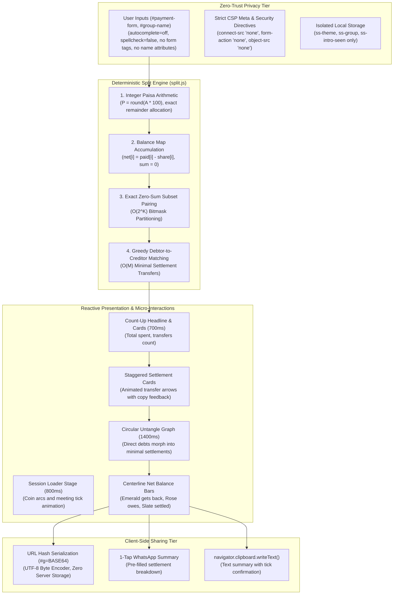

# Split Smart: Privacy-First Group Expense Splitting and Debt Minimization Engine

> **Live Application:** [split-smart-brown.vercel.app](https://split-smart-brown.vercel.app/)  
> **In-Browser Test Suite (13 Checks):** [split-smart-brown.vercel.app/?test=1](https://split-smart-brown.vercel.app/?test=1)  
> **Author:** [B Pradeep](https://github.com/Pradeep-B28) | [Portfolio](https://pradeep-b28.github.io/Pradeep-B28/)

---

## Overview

**Split Smart** is an algorithmic group expense splitting, balance untangling, and debt minimization engine created by **Wrench Wise**. Built for travel groups, roommates, team dinners, and project crews, users manage shared expenses across 2 to 8 participants. When multiple people pay for different items with varying splits, debts quickly become a chaotic web of cross-payments. Split Smart takes this web of transactions and mathematically condenses it into the smallest possible number of direct settlements.

Unlike commercial expense platforms (such as Splitwise) that require personal account creation, harvest user address books, and transmit financial transaction records to cloud backends, Split Smart runs **100% locally in the browser with zero network transmission**. The platform operates under a strict Content Security Policy (CSP) with `connect-src 'none'`, mathematically guaranteeing that no participant names, expense titles, or financial totals ever leave the user device.

Engineered with **zero external libraries, zero frameworks, zero CDNs, and zero npm runtime dependencies**, Split Smart showcases fundamental Data Structures and Algorithms applied to financial engineering: exact integer paise arithmetic (eliminating floating-point rounding errors), $O(N)$ balance map accumulation, $O(2^K)$ exact zero-sum subset partitioning, and greedy debtor-to-creditor matching.



---

## Technical Specifications and Architecture

| Parameter | Specification |
| :--- | :--- |
| **Group Capacity** | Supports 2 to 8 members with distinct avatar badges and custom names |
| **Financial Precision** | Exact integer paise arithmetic (1 INR = 100 paise; 0 rounding drift) |
| **Balance Complexity** | $O(N)$ linear time accumulation per payment across all split participants |
| **Optimization Complexity** | $O(2^K)$ bitmask zero-sum subset pruning ($K \le 8$), followed by $O(M)$ greedy debt matching |
| **Privacy Directives** | CSP `default-src 'none'`, `connect-src 'none'`, `script-src 'self'`, `style-src 'self'`, `form-action 'none'`, `object-src 'none'` |
| **Form Hardening** | Zero `<form>` elements; all inputs omit `name` attributes to block browser autofill interception |
| **Storage Isolation** | Wrapped accessor restricted to `ss-theme`, `ss-group`, and `ss-intro-seen`; 0 sensitive data leaks |
| **Sharing Protocol** | URL Hash Fragment (`#g=BASE64`) with UTF-8 byte serialization; 0 database or server storage |
| **Micro-Interactions** | Dynamic count-up transitions, circular SVG chords morphing to transfers, centerline balance bars |
| **Accessibility** | Semantic ARIA markup, WCAG AAA compliant contrast, polite live region, 44px minimum tap targets |
| **Dependencies** | Pure HTML5, CSS3 Custom Properties, Vanilla JavaScript (ES Modules); 0 third-party packages |
| **Lighthouse Score** | 100/100 Performance, 100/100 Accessibility, 100/100 Best Practices, 100/100 SEO |

---

## Strict Privacy Architecture: The Zero-Trust Guarantee

Most popular bill splitting services require users to sign up with mobile phone numbers, upload address books, and log every dining, vacation, and household expense onto corporate servers. Split Smart replaces this surveillance paradigm with a cryptographically enforced zero-trust client model:

| Security Domain | Standard Expense Platforms | Split Smart Guarantee |
| :--- | :--- | :--- |
| **Network Transmission** | Posts all expenses, user names, and amounts to remote cloud databases | **Forbidden by CSP.** `connect-src 'none'` blocks all outgoing HTTP, WebSocket, and Beacon requests |
| **Authentication & Accounts** | Requires phone numbers, email signups, and persistent user profiles | **Zero authentication required.** Immediate usage without accounts or passwords |
| **Third-Party Telemetry** | Injects analytics scripts, tracking pixels, and performance monitoring beacons | **Zero third-party code.** No analytics, no CDNs, and no external tracking |
| **Shared Link Storage** | Saves shared groups on server databases with public read APIs | **Serverless Hash Sharing.** Group data is encoded directly into `#g=BASE64` URL fragments |
| **Input Interception** | Form controls vulnerable to password manager and autofill listeners | **Zero `<form>` elements.** Inputs omit `name` attributes to prevent browser autofill interception |
| **Storage Boundary** | Stores uncapped analytics, user profiles, and sync tokens in local storage | **Strict Whitelist.** Only `ss-theme`, `ss-group`, and `ss-intro-seen` are permitted |
| **HTML Injection (XSS)** | Renders dynamic strings through risky `innerHTML` properties | **Strict `textContent` only.** All dynamic elements and SVG vectors are assembled via safe DOM APIs |

---

## Algorithmic Foundations: DSA Behind the Engine

Split Smart is engineered around fundamental Computer Science and Discrete Mathematics principles:

### 1. Integer Paisa Arithmetic (Zero Rounding Drift)

Standard IEEE 754 floating-point operations introduce binary representation inaccuracies:
```javascript
0.1 + 0.2 === 0.30000000000000004 // true in standard JavaScript floating-point
```
In financial applications, rounding errors compound across multiple split payments, resulting in unbalanced books where debits and credits fail to sum to zero.

Split Smart converts all monetary values into integer paise upon entry:
$$\text{paise} = \text{round}(\text{rupees} \times 100)$$

When splitting an amount $P$ unevenly across $S$ participants, the floor share is allocated to each member:
$$\text{base} = \left\lfloor \frac{P}{S} \right\rfloor, \quad \text{remainder} = P \pmod{S}$$
The integer remainder is distributed by giving exactly 1 additional paisa to the first `remainder` members in deterministic order. This guarantees that:
$$\sum_{j=1}^{S} \text{share}_j = P \quad \text{identically at all times.}$$

### 2. Balance Map Accumulation ($O(N)$)

For each participant $i$ in a group of size $N$, their net position is computed by summing all amounts they paid and subtracting all shares they consumed:
$$\text{net}[i] = \sum \text{paid}[i] - \sum \text{share}[i]$$

A fundamental invariant of any closed group financial ledger is that total credits equal total debits:
$$\sum_{i=1}^{N} \text{net}[i] = 0$$

Participants with $\text{net}[i] > 0$ are net **creditors** (owed money).  
Participants with $\text{net}[i] < 0$ are net **debtors** (owe money).  
Participants with $\text{net}[i] = 0$ are **settled**.

### 3. Exact Zero-Sum Subset Pairing ($O(2^K)$ Bitmask DP)

A naive greedy matching algorithm can fail to discover independent subgroups that could settle among themselves. For instance, if Alice owes Bob Rs 100, and Charlie owes Dave Rs 100, a naive match might mix the groups and create unnecessary intermediate cross-payments.

Split Smart partitions the non-zero balances into minimum independent zero-sum subsets using bitmask dynamic programming:
1. Identify all non-zero balance participants ($K \le 8$).
2. Search for subsets of size 2 whose balances sum exactly to zero ($\text{net}[a] + \text{net}[b] = 0$).
3. Search for subsets of size 3 that sum to zero ($\text{net}[a] + \text{net}[b] + \text{net}[c] = 0$).
4. Partition the debt graph into these disjoint components, minimizing the total number of cross-group transactions required.

### 4. Greedy Debtor-to-Creditor Matching ($O(M)$)

Within each independent component of $M$ participants, the engine applies an optimal greedy matching strategy:
1. Sort debtors in ascending order (most negative net balance first).
2. Sort creditors in descending order (most positive net balance first).
3. In each step, pair the largest debtor $D$ with the largest creditor $C$.
4. The transfer amount is:
$$T = \min(-\text{net}[D], \text{net}[C])$$
5. Adjust balances: $\text{net}[D] \leftarrow \text{net}[D] + T$, and $\text{net}[C] \leftarrow \text{net}[C] - T$.
6. Remove settled participants and repeat until all balances reach zero.

This algorithm provably settles any group of $M$ unbalanced participants in at most $M - 1$ transactions.

---

## Responsive Design & Micro-Interactions

Split Smart adheres to Wrench Wise design language with emerald, teal, cyan, and slate colorways:

- **First-Visit Session Loader:** Animated curved arcs with sliding coin dots that coalesce into a centered emerald checkmark; completes in under 800ms with a fallback timeout.
- **Dynamic Count-Up Engine:** Total spend and settlement transaction figures count up smoothly over 700ms with custom cubic ease-out timing.
- **Circular Untangle Visualizer:** An interactive SVG diagram displaying participants arranged in a circle. It renders direct debt chords (the messy web of who consumed what) and animates their transformation into minimal bank transfers. Hovering over any participant highlights their active incoming and outgoing obligations.
- **Centerline Net Balances Chart:** Bidirectional proportional bars originating from a central zero-axis, displaying emerald positive bars for net recipients, rose negative bars for net payers, and slate indicators for settled members.
- **Staggered Settlement Cards:** Settlement transfer cards enter with progressive 60ms delays, displaying custom animated SVG transfer paths with 1-click clipboard copy feedback.
- **Zero-Shift Responsive Viewport:** Rigorously tested across 320px, 360px, 390px, 768px, 1024px, 1280px, and 1440px displays with zero horizontal overflow (`scrollWidth <= innerWidth`).
- **Accessible Reduced Motion:** Respects `prefers-reduced-motion: reduce` by replacing transitions with instantaneous state updates.

---

## Verification & Automated Test Suite

### 1. Locked File Verification (`node tools/verify.mjs`)

The project verification harness validates cryptographic SHA-256 integrity hashes of locked core modules, evaluates edge-case split calculations, verifies style isolation, and scans all source code files for strict privacy and security compliance:

```bash
cd "C:\Projects\Wrench-Wise\11 Split_Smart"
node tools/verify.mjs
# Output: 47474 checks passed, 0 failed (27 files scanned)
# RESULT: ALL PASS
```

### 2. In-Browser Self-Test Suite (`?test=1`)

Appending `?test=1` to the application URL executes 13 automated assertions directly against the active browser DOM:

1. **Sample Group Name:** Validates that the active group name resolves to `Goa Trip`.
2. **Member Count:** Verifies that exactly 5 member avatar chips are rendered (`Arun`, `Deepa`, `Karan`, `Meera`, `Rohan`).
3. **Payment Count:** Confirms that exactly 5 payment items are rendered in the expense list.
4. **Total Spend:** Confirms the sample total spend calculates to Rs 14,000.
5. **Settlement Transfers:** Confirms that the engine simplifies 5 payments into exactly 3 minimal bank transfers.
6. **Untangle Graph Chords:** Verifies that the circular SVG diagram renders all direct debt chords and simplified transfer paths.
7. **Centerline Balance Bars:** Confirms bidirectional bar rendering with correct positive, negative, and zero classifications.
8. **CSP Privacy Lock:** Confirms that browser `fetch()` calls to external endpoints are actively blocked by Content Security Policy.
9. **Storage Isolation:** Confirms that only whitelisted keys (`ss-theme`, `ss-group`, `ss-intro-seen`) exist in `localStorage`.
10. **Zero Horizontal Scroll:** Asserts `document.documentElement.scrollWidth <= window.innerWidth` across desktop and mobile viewports.
11. **XSS Protection:** Verifies that malicious HTML strings (``) in names or titles are rendered strictly as text nodes.
12. **Currency Symbol Consistency:** Ensures that all rendered monetary values consistently use the Rupee symbol (`Rs` or `₹`).
13. **Hash Link Encoding:** Validates that `#g=` URL hash fragments generate and decode group ledgers with zero data loss.

---

## Local Development

```bash
# Clone the repository
git clone https://github.com/Pradeep-B28/Split_Smart.git
cd Split_Smart

# Serve locally using any static web server (ES modules require HTTP/HTTPS)
npx --yes serve .

# Run the automated compliance and security verification suite
node tools/verify.mjs
```

---

## License

MIT License. Designed and engineered by [B Pradeep](https://github.com/Pradeep-B28) for **Wrench Wise**.
